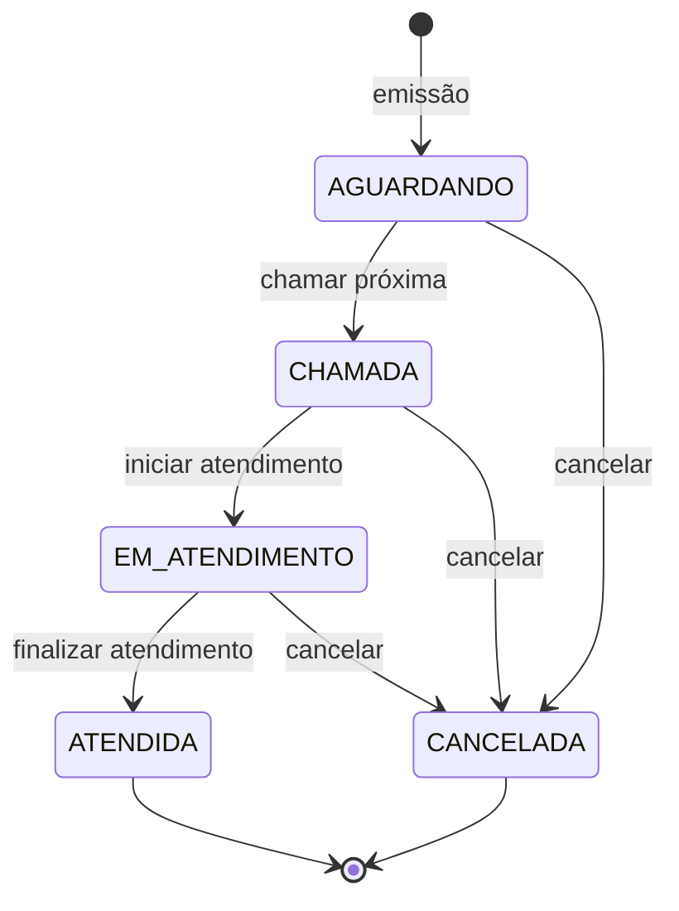

# Fila de Atendimento — API


MVP de gerenciamento de filas de atendimento presencial, desenvolvido como projeto do **Programa Residência em TIC (Capacita Brasil / iRede)**.

A solução é **API-only** (sem frontend), com contrato REST documentado via **Swagger/OpenAPI**, autenticação **JWT**, autorização por perfis e persistência em **PostgreSQL**. Todo o ambiente sobe com **Docker Compose**.

---

## Sumário

- [Descrição do projeto](#descrição-do-projeto)
- [Funcionalidades](#funcionalidades)
- [Regras de negócio](#regras-de-negócio)
- [Tecnologias](#tecnologias)
- [Arquitetura](#arquitetura)
- [Estrutura do projeto](#estrutura-do-projeto)
- [Instalação](#instalação)
- [Configuração](#configuração)
- [Execução](#execução)
- [Docker](#docker)
- [Swagger](#swagger)
- [Usuários de demonstração](#usuários-de-demonstração)
- [Fluxo de exemplo](#fluxo-de-exemplo)
- [Testes e resultados](#testes-e-resultados)
- [Prints sugeridos](#prints-sugeridos)
- [Documentação](#documentação)
- [Licença](#licença)

---

## Descrição do projeto

O sistema digitaliza o atendimento presencial: o cidadão retira uma senha, acompanha sua posição, é chamado em ordem de chegada e o atendente registra o atendimento do início ao fim. A gestão ganha histórico, auditoria e indicadores de tempo.

**Problema resolvido:** filas manuais geram desordem, favorecimento, perda de histórico e ausência de métricas. A API centraliza numeração, chamada FIFO, transições de status e auditoria, com consistência sob concorrência.

**Escopo:** apenas backend. Não há interface gráfica neste repositório.

**Destaques:**

- Numeração reiniciada diariamente por fila (`A001`, `A002`, …).
- FIFO garantido com lock pessimista no banco.
- Ciclo de vida da senha protegido por invariantes de domínio.
- Auditoria de todas as transições em `senha_eventos`.
- Erros padronizados no RFC 9457 (`ProblemDetail`).
- 120 testes automatizados e cobertura de **93,3%** de linhas.

---

## Funcionalidades

| Código | Funcionalidade | Endpoint principal |
| --- | --- | --- |
| RF001 | Emitir senha | `POST /api/senhas` |
| RF002 | Consultar última senha do dia | `GET /api/senhas/ultima` |
| RF003 | Painel da fila em tempo real | `GET /api/fila` |
| RF004 | Consultar senha e posição | `GET /api/senhas/{id}` |
| RF005 | Estatísticas do dia | `GET /api/fila/estatisticas` |
| RF006 | Chamar próxima senha (FIFO) | `POST /api/fila/proxima` |
| RF007 | Iniciar atendimento | `POST /api/atendimentos/iniciar` |
| RF008 | Finalizar atendimento | `POST /api/atendimentos/finalizar` |
| RF009 | Listar senhas com filtros | `GET /api/senhas` |
| RF010 | Histórico de atendimentos | `GET /api/atendimentos` |
| RF011 | Consultar atendimento | `GET /api/atendimentos/{id}` |
| RF012 | Cancelar senha | `POST /api/senhas/{id}/cancelar` |
| RF013 | Login e usuário atual | `POST /api/auth/login` · `GET /api/auth/me` |
| RF014 | Administrar filas | `/api/filas/**` |
| RF015 | Administrar usuários | `/api/usuarios/**` |
| RF016 | Auditoria de transições | tabela `senha_eventos` |

---

## Regras de negócio

| Regra | Descrição |
| --- | --- |
| **RN001** | Numeração sequencial por fila, reiniciada a cada dia: `PREFIXO` + 3 dígitos (`A001`). |
| **RN002** | Chamada estritamente FIFO (`dataGeracao`, `sequencia`). |
| **RN003** | Apenas senhas `AGUARDANDO` podem ser chamadas. |
| **RN004** | Cada senha possui no máximo um atendimento. |
| **RN005** | Só finaliza atendimento iniciado; ao finalizar, a senha vira `ATENDIDA`. |
| **RN006** | Cancelamento é definitivo: a senha não retorna à fila. |
| **RN007** | Toda transição de status é auditada. |
| **RN008** | Fila inativa não emite nem chama senhas. |
| **RN009** | Administrador não pode desativar a si mesmo. |
| **RN010** | Exclusões de fila/usuário são lógicas. |

### Ciclo de vida da senha



---

## Tecnologias

| Camada | Tecnologia |
| --- | --- |
| Linguagem | Java 21 (records, `java.time`, text blocks) |
| Framework | Spring Boot 3.5.16 |
| Web | Spring MVC + Jakarta Bean Validation |
| Persistência | Spring Data JPA + Hibernate 6 |
| Banco | PostgreSQL 16 (H2 em modo PostgreSQL nos testes) |
| Migrações | Flyway (`V1`, `V2`, `V3`) |
| Segurança | Spring Security + JWT HS256 (jjwt 0.12.6) + BCrypt |
| Documentação | springdoc-openapi 2.8.17 (Swagger UI) |
| Mapeamento | MapStruct 1.6.3 |
| Boilerplate | Lombok |
| Testes | JUnit 5, Mockito, AssertJ, Spring Boot Test, MockMvc, H2 |
| Cobertura | JaCoCo 0.8.12 — gate de 80% de linhas |
| Build | Maven (wrapper incluído) |
| Container | Docker multi-stage + Docker Compose |

---

## Arquitetura

Monólito modular em camadas, com dependências apontando para o domínio:

```text
Controller → Service → Repository → Entity
     │           │
     │           ├── Mapper (DTO ↔ Entity)
     │           └── Exception Handler / Security
     └── DTOs de entrada e saída
```

- **Controllers:** apenas HTTP, validação e códigos de status.
- **Services:** regras de negócio, transações e auditoria.
- **Repositories:** Spring Data JPA, Specifications e locks.
- **Entities:** invariantes de domínio (transições, numeração, duração).
- **DTOs + MapStruct:** contrato desacoplado do schema.
- **Exception Handler:** erros RFC 9457.
- **Security:** JWT stateless + RBAC (`USUARIO`, `ATENDENTE`, `ADMINISTRADOR`).

Detalhes e diagramas: [`docs/ARQUITETURA.md`](docs/ARQUITETURA.md) · Modelo de dados: [`docs/MER.md`](docs/MER.md).

---

## Estrutura do projeto

```text
.
├── Dockerfile
├── docker-compose.yml
├── .env.example
├── pom.xml
├── mvnw / mvnw.cmd
├── docs/
│   ├── API.md
│   ├── ARQUITETURA.md
│   ├── MER.md
│   ├── TESTES.md
│   ├── REQUISITOS.md
│   ├── RELATORIO-ACADEMICO.md
│   ├── APRESENTACAO.md
│   ├── ROTEIRO-APRESENTACAO.md
│   ├── RESUMO-EXECUTIVO.md
│   ├── CHECKLIST-ENTREGA.md
│   └── FilaAtendimento.postman_collection.json
└── src/
    ├── main/
    │   ├── java/br/com/capacitabrasil/fila/
    │   │   ├── config/        # OpenAPI, CORS, JWT, Clock, trace id
    │   │   ├── controller/    # endpoints REST
    │   │   ├── dto/           # request / response records
    │   │   ├── entity/        # entidades JPA e enums
    │   │   ├── exception/     # exceções + handler global
    │   │   ├── mapper/        # MapStruct
    │   │   ├── repository/    # Spring Data + Specifications
    │   │   ├── security/      # JWT, filtros, UserDetails
    │   │   ├── service/       # regras de negócio
    │   │   └── util/          # formatação e duração
    │   └── resources/
    │       ├── application.yml
    │       ├── application-dev.yml
    │       └── db/migration/  # V1, V2, V3 (Flyway)
    └── test/
        ├── java/...           # unitários + integração
        └── resources/application-test.yml
```

---

## Instalação

### Pré-requisitos

**Com Docker (recomendado):**

- Docker Desktop / Docker Engine
- Docker Compose v2+

**Local:**

- JDK 21
- PostgreSQL 16 (ou Docker apenas para o banco)
- Maven (opcional — o wrapper já está incluído)

### Clonar e preparar

```bash
git clone <url-do-repositorio>
cd "Projeto Padrão"

# opcional: personalizar credenciais e segredo JWT
cp .env.example .env
```

---

## Configuração

| Variável | Padrão | Descrição |
| --- | --- | --- |
| `DB_URL` | `jdbc:postgresql://localhost:5432/fila_atendimento` | URL JDBC |
| `DB_USER` | `fila` | Usuário do banco |
| `DB_PASSWORD` | `fila123` | Senha do banco |
| `SERVER_PORT` | `8080` | Porta HTTP |
| `APP_TIMEZONE` | `America/Sao_Paulo` | Fuso da numeração diária e timestamps |
| `JWT_SECRET` | valor de exemplo | Segredo Base64 (≥ 256 bits) |
| `JWT_EXPIRATION_MS` | `7200000` | Expiração do token (2 h) |
| `FILA_PREFIXO_PADRAO` | `A` | Fila usada quando `filaId` é omitido |
| `CORS_ALLOWED_ORIGINS` | `http://localhost:3000,...` | Origens permitidas |
| `POSTGRES_DB` / `POSTGRES_USER` / `POSTGRES_PASSWORD` | `fila_atendimento` / `fila` / `fila123` | Credenciais do container |
| `JAVA_OPTS` | `-XX:MaxRAMPercentage=75.0 ...` | Opções da JVM no container |

> Em produção, gere um segredo exclusivo com `openssl rand -base64 64`, troque as senhas de exemplo e **não versione o `.env`**.

---

## Execução

### Opção 1 — Docker Compose (API + PostgreSQL)

```bash
docker compose up --build -d
docker compose ps          # ambos devem ficar "healthy"
docker compose logs -f app # acompanhar os logs
```

A API fica em `http://localhost:8080`. O Flyway aplica as migrações automaticamente e o seed cria filas e usuários de demonstração.

Para parar:

```bash
docker compose down      # mantém o volume do banco
docker compose down -v   # remove também os dados
```

### Opção 2 — Banco no Docker e API local

```bash
docker compose up -d postgres
./mvnw spring-boot:run -Dspring-boot.run.profiles=dev
```

### Opção 3 — Build local do jar

```bash
./mvnw clean package
java -jar target/fila-atendimento.jar
```

Exemplo com variáveis inline:

```bash
DB_URL=jdbc:postgresql://localhost:5432/fila_atendimento \
DB_USER=fila \
DB_PASSWORD=fila123 \
JWT_SECRET="<segredo-base64>" \
java -jar target/fila-atendimento.jar
```

> No Windows, use `.\mvnw.cmd` e `Copy-Item .env.example .env`.

---

## Docker

- **Dockerfile multi-stage:** build com Maven 3.9 + JRE 21 Alpine, execução como usuário não-root.
- **docker-compose.yml:** `postgres:16-alpine` + API, com healthchecks, volume `fila_pgdata`, rede dedicada e variáveis de ambiente.
- **Healthchecks:** banco via `pg_isready`; API via `/actuator/health`.
- **Fuso:** `TZ=America/Sao_Paulo` no banco e na API para consistência dos horários.

Comandos úteis:

```bash
docker compose ps
docker compose logs -f app
docker compose exec postgres psql -U fila -d fila_atendimento
docker compose down -v && docker compose up -d   # resetar o banco para o seed
```

---

## Swagger

Com a aplicação em execução:

| Recurso | URL |
| --- | --- |
| Swagger UI | <http://localhost:8080/swagger-ui/index.html> |
| OpenAPI JSON | <http://localhost:8080/v3/api-docs> |
| Health check | <http://localhost:8080/actuator/health> |

**Como autenticar no Swagger:**

1. Execute `POST /api/auth/login` com um usuário de demonstração.
2. Copie o `token` da resposta.
3. Clique em **Authorize** e informe o token (o esquema é `bearerAuth`).
4. Os endpoints protegidos passam a aceitar as chamadas.

Referência completa com payloads e códigos de erro: [`docs/API.md`](docs/API.md).

---

## Usuários de demonstração

Criados pela migração `V3__dados_iniciais.sql`:

| Perfil | E-mail | Senha |
| --- | --- | --- |
| ADMINISTRADOR | `admin@fila.local` | `Admin@123` |
| ATENDENTE | `atendente@fila.local` | `Atendente@123` |
| USUARIO | `usuario@fila.local` | `Usuario@123` |

Filas iniciais: **Geral** (`A`) e **Prioritária** (`P`).

### Autorização por perfil

| Recurso | USUARIO | ATENDENTE | ADMINISTRADOR |
| --- | :---: | :---: | :---: |
| `POST /api/auth/login` | público | público | público |
| `GET /api/auth/me` | ✅ | ✅ | ✅ |
| `POST /api/senhas` | ✅ | ✅ | ✅ |
| `GET /api/senhas/**` | ✅ | ✅ | ✅ |
| `POST /api/senhas/{id}/cancelar` | ❌ | ✅ | ✅ |
| `GET /api/fila`, `/api/fila/estatisticas` | ✅ | ✅ | ✅ |
| `POST /api/fila/proxima` | ❌ | ✅ | ✅ |
| `/api/atendimentos/**` | ❌ | ✅ | ✅ |
| `GET /api/filas/**` | ✅ | ✅ | ✅ |
| `POST/PUT/DELETE /api/filas/**` | ❌ | ❌ | ✅ |
| `/api/usuarios/**` | ❌ | ❌ | ✅ |

---

## Fluxo de exemplo

```bash
BASE=http://localhost:8080

# 1) Login como atendente
TOKEN=$(curl -s -X POST "$BASE/api/auth/login" \
  -H "Content-Type: application/json" \
  -d '{"email":"atendente@fila.local","senha":"Atendente@123"}' \
  | jq -r .token)

# 2) Emitir senha na fila Geral (id 1)
curl -s -X POST "$BASE/api/senhas" \
  -H "Authorization: Bearer $TOKEN" \
  -H "Content-Type: application/json" \
  -d '{"filaId":1}'

# 3) Consultar o painel
curl -s "$BASE/api/fila?filaId=1" -H "Authorization: Bearer $TOKEN"

# 4) Chamar a próxima senha
curl -s -X POST "$BASE/api/fila/proxima" \
  -H "Authorization: Bearer $TOKEN" \
  -H "Content-Type: application/json" \
  -d '{"filaId":1,"guiche":"G1"}'

# 5) Iniciar atendimento (use o senhaId retornado)
curl -s -X POST "$BASE/api/atendimentos/iniciar" \
  -H "Authorization: Bearer $TOKEN" \
  -H "Content-Type: application/json" \
  -d '{"senhaId":1,"guiche":"G1"}'

# 6) Finalizar (use o id do atendimento retornado)
curl -s -X POST "$BASE/api/atendimentos/finalizar" \
  -H "Authorization: Bearer $TOKEN" \
  -H "Content-Type: application/json" \
  -d '{"atendimentoId":1,"observacao":"Atendimento concluído"}'
```

> `jq` é opcional. A coleção Postman em [`docs/FilaAtendimento.postman_collection.json`](docs/FilaAtendimento.postman_collection.json) executa o fluxo completo.

---

## Testes e resultados

```bash
./mvnw test      # apenas testes
./mvnw verify    # testes + cobertura + gate de 80%
```

| Métrica | Resultado |
| --- | --- |
| Testes | **120** (82 unitários + 38 de integração) |
| Falhas | **0** |
| Cobertura de linhas | **93,3%** (725/777) |
| Cobertura de branches | 70,6% (137/194) |
| Gate JaCoCo | ≥ 80% — **atendido** |
| Build | **BUILD SUCCESS** |

- Relatório HTML: `target/site/jacoco/index.html`.
- Integração com **H2 em modo PostgreSQL** e as mesmas migrações Flyway.
- Estratégia e suítes: [`docs/TESTES.md`](docs/TESTES.md).

---

## Prints sugeridos

Sugestão de capturas para o relatório/apresentação:

| # | Print | O que destacar |
| --- | --- | --- |
| 1 | `docker compose ps` | `fila-api` e `fila-postgres` como **healthy** |
| 2 | Swagger UI — visão geral | Título, versão 1.0.0 e os 17 paths agrupados por tag |
| 3 | Swagger UI — `POST /api/senhas` | Corpo da requisição e resposta **201** com `A001` |
| 4 | Swagger UI — Authorize | Token Bearer configurado |
| 5 | `GET /api/fila` | Painel com `aguardando`, `chamadas` e `emAtendimento` |
| 6 | `POST /api/fila/proxima` | Resposta com `numero`, `guiche` e `atendimentoId` |
| 7 | `POST /api/atendimentos/finalizar` | Status `ATENDIDA` e `duracaoSegundos` |
| 8 | `GET /api/fila/estatisticas` | Tempos médios e totais do dia |
| 9 | Erro 401/403 | `ProblemDetail` com `codigo`, `traceId` e `instance` |
| 10 | IntelliJ — estrutura de pacotes | Camadas `controller/service/repository/entity` |
| 11 | Terminal — `mvn verify` | `Tests run: 120` e `BUILD SUCCESS` |
| 12 | Relatório JaCoCo | Cobertura de 93,3% e verde por pacote |
| 13 | Banco — `\dt` + `flyway_schema_history` | 6 tabelas e as 3 migrações aplicadas |
| 14 | GitHub — README | Documentação e badges |

> Dica: use o Swagger UI para os prints de API; ele já mostra método, rota, payload e resposta formatados.

---

## Documentação

| Documento | Conteúdo |
| --- | --- |
| [`docs/REQUISITOS.md`](docs/REQUISITOS.md) | Levantamento de requisitos, atores, casos de uso, RF, RNF, RN e rastreabilidade |
| [`docs/RELATORIO-ACADEMICO.md`](docs/RELATORIO-ACADEMICO.md) | Relatório completo com análise crítica, SOLID/Clean Code, DER e conclusão |
| [`docs/ARQUITETURA.md`](docs/ARQUITETURA.md) | Camadas, diagramas, decisões, concorrência e segurança |
| [`docs/MER.md`](docs/MER.md) | DER em Mermaid, dicionário de dados, índices e transições |
| [`docs/API.md`](docs/API.md) | Referência completa dos endpoints, payloads e erros |
| [`docs/TESTES.md`](docs/TESTES.md) | Pirâmide de testes, suítes, cobertura e troubleshooting |
| [`docs/APRESENTACAO.md`](docs/APRESENTACAO.md) | Apresentação em 10 slides |
| [`docs/ROTEIRO-APRESENTACAO.md`](docs/ROTEIRO-APRESENTACAO.md) | Roteiro cronometrado de 5 minutos |
| [`docs/RESUMO-EXECUTIVO.md`](docs/RESUMO-EXECUTIVO.md) | Resumo de uma página para envio ao professor |
| [`docs/CHECKLIST-ENTREGA.md`](docs/CHECKLIST-ENTREGA.md) | Checklist de submissão |
| [`docs/FilaAtendimento.postman_collection.json`](docs/FilaAtendimento.postman_collection.json) | Coleção Postman com o fluxo completo |

---

## Licença

Projeto acadêmico desenvolvido para o **Programa Residência em TIC — Capacita Brasil / iRede**.
