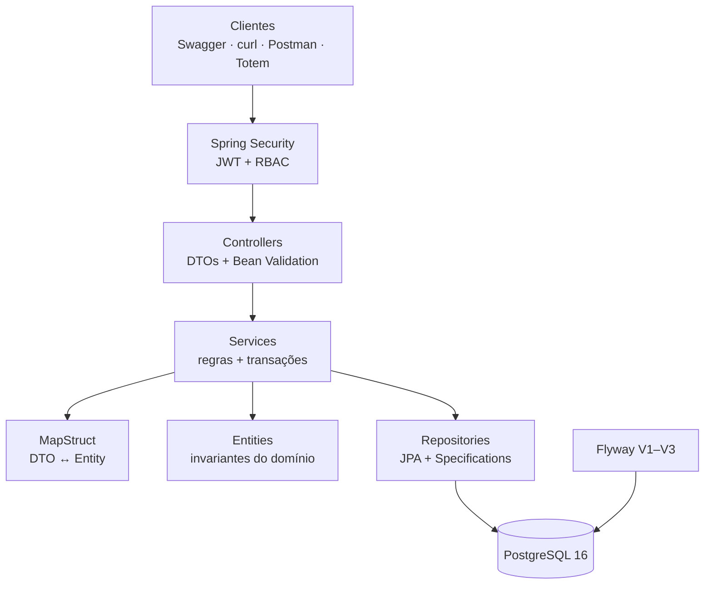
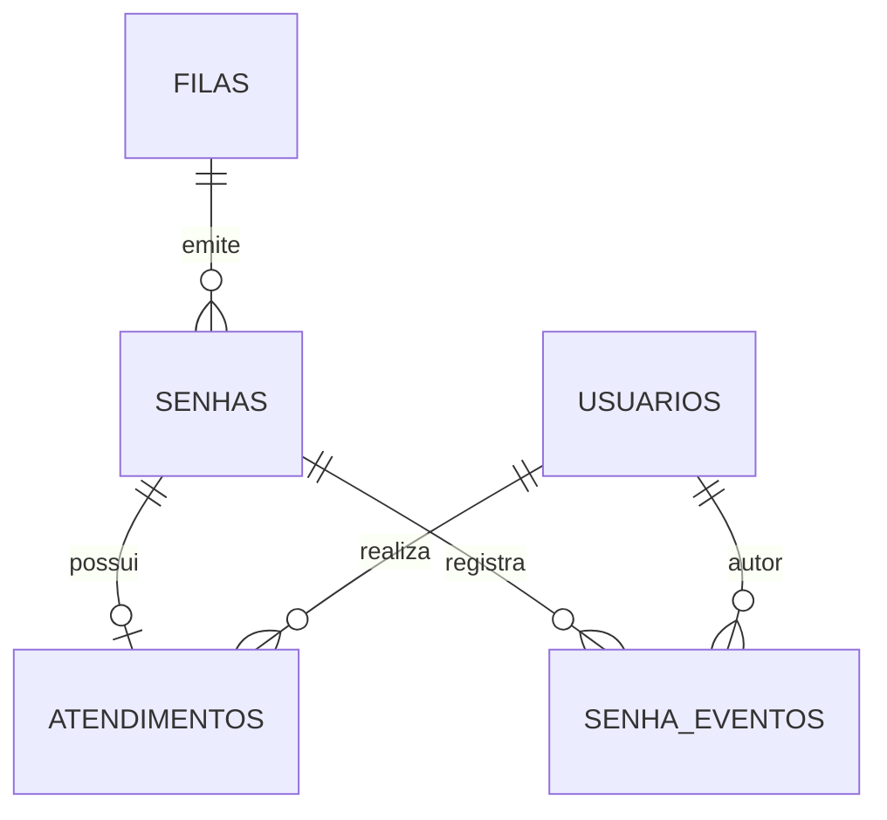

# Apresentação — API de Fila de Atendimento

> **Formato:** 10 slides · Markdown · duração alvo: 5 minutos
> **Dica:** abra este arquivo em um visualizador Markdown (VS Code, Obsidian, Marp) e avance pelos separadores `---`.

---

## Slide 1 — Capa

# Fila de Atendimento
### API REST para gestão de filas presenciais

**Java 21 · Spring Boot 3 · PostgreSQL 16 · Docker**

Programa Residência em TIC — Capacita Brasil / iRede
Aluno: _(seu nome)_ · Orientador: _(nome do professor)_

Repositório: `github.com/<usuario>/<repo>` · Swagger: `localhost:8080/swagger-ui/index.html`

> **Fala:** “Vou apresentar o MVP de uma API que digitaliza filas de atendimento presencial, cobrindo da emissão da senha ao indicador de tempo médio.”

---

## Slide 2 — Problema

# O problema

- Senhas de papel se perdem e são duplicadas
- Chamadas fora de ordem geram desconfiança
- Nenhum histórico de quem atendeu, quando e onde
- Gestão sem métricas de espera e atendimento
- Acesso sem controle por perfil

> **Frase de efeito:** “Sem sistema, a fila existe, mas a gestão não enxerga nada.”

**Visual sugerido:** foto de fila manual + ícones de “sem histórico”, “sem métrica”, “sem controle”.

---

## Slide 3 — Solução Proposta

# A solução

**API REST** que centraliza o ciclo completo:

1. **Emitir** senha com numeração diária por fila (`A001`)
2. **Acompanhar** posição e painel em tempo real
3. **Chamar** a próxima respeitando FIFO
4. **Atender** do início ao fim, com guichê e duração
5. **Auditar** todas as transições de status
6. **Medir** tempos médios e volumes do dia

**Perfis:** `USUARIO` · `ATENDENTE` · `ADMINISTRADOR`

> **Fala:** “O escopo é backend: o contrato REST está pronto para alimentar totens, apps e painéis.”

---

## Slide 4 — Arquitetura

# Arquitetura

**Decisões-chave**

| Decisão | Motivo |
| --- | --- |
| Lock pessimista em `Fila` e na busca FIFO | Evita números duplicados e chamada dupla |
| DTOs + MapStruct | Contrato independente do schema |
| `ProblemDetail` (RFC 9457) | Erros padronizados |
| `Clock` injetável | Virada diária testável |
| Stateless + JWT | Escala horizontal |

> **Fala:** “É um monólito modular em camadas, inspirado em Clean Architecture, com o domínio protegendo suas invariantes.”

---

## Slide 5 — Tecnologias

# Tecnologias

| Camada | Stack |
| --- | --- |
| Linguagem | **Java 21** |
| Framework | **Spring Boot 3.5.16** (Web, Data JPA, Security, Validation, Actuator) |
| Banco | **PostgreSQL 16** + **Flyway** |
| Segurança | **JWT HS256** + **BCrypt** |
| Documentação | **springdoc-openapi / Swagger UI** |
| Mapeamento | **MapStruct** + **Lombok** |
| Testes | **JUnit 5**, Mockito, AssertJ, MockMvc, H2 |
| Qualidade | **JaCoCo** (gate de 80%) |
| Infra | **Docker multi-stage** + **Docker Compose** |

> **Fala:** “Todas as escolhas são padrão de mercado e cobrem o ciclo completo de desenvolvimento.”

---

## Slide 6 — Banco de Dados

# Banco de dados

**5 tabelas + 1 de histórico do Flyway**

| Tabela | Papel |
| --- | --- |
| `filas` | Configuração e sequência diária |
| `usuarios` | Perfis e exclusão lógica |
| `senhas` | Ciclo de vida e timestamps |
| `atendimentos` | Execução 1:1 com a senha |
| `senha_eventos` | Auditoria das transições |

**7 índices** para painel, FIFO, histórico e auditoria.

> **Fala:** “O schema é versionado por Flyway e o Hibernate só valida — o banco é a fonte da verdade.”

---

## Slide 7 — APIs

# APIs

**24 operações em 17 paths**, documentadas no Swagger

| Grupo | Exemplos |
| --- | --- |
| Autenticação | `POST /api/auth/login` · `GET /api/auth/me` |
| Senhas | `POST /api/senhas` · `GET /api/senhas/{id}` · `POST /api/senhas/{id}/cancelar` |
| Fila | `GET /api/fila` · `GET /api/fila/estatisticas` · `POST /api/fila/proxima` |
| Atendimentos | `POST /api/atendimentos/iniciar` · `/finalizar` · `GET /api/atendimentos` |
| Administração | `/api/filas/**` · `/api/usuarios/**` |

**Qualidade do contrato**

- Validação com mensagens por campo
- Paginação e filtros
- Erros RFC 9457 com `codigo` e `traceId`
- 401/403 padronizados
- `Location` no `201 Created`

> **Fala:** “O contrato é o produto: qualquer frontend consegue consumir sem conhecer o banco.”

---

## Slide 8 — Demonstração

# Demonstração ao vivo

**Roteiro (≈ 2 minutos)**

1. `docker compose ps` → **API e banco healthy**
2. Swagger → **Authorize** com token do login
3. Emitir `A001` → **201 Created**
4. Painel → senha em `AGUARDANDO`
5. Chamar próxima → `CHAMADA` + `atendimentoId`
6. Iniciar → `EM_ATENDIMENTO`
7. Finalizar → **`ATENDIDA`** + duração
8. Estatísticas → tempos médios e totais
9. Erro proposital → **409** com `ProblemDetail`

> **Plano B:** se a rede falhar, mostrar os prints salvos e a coleção Postman.

---

## Slide 9 — Resultados

# Resultados

| Indicador | Resultado |
| --- | --- |
| Testes automatizados | **120** |
| Falhas | **0** |
| Cobertura de linhas | **93,3%** (725/777) |
| Gate de cobertura | 80% — **atendido** |
| Endpoints documentados | **24** em 17 paths |
| Migrações Flyway | **3** aplicadas |
| Stack Docker | **2 containers healthy** |
| Smoke test end-to-end | **OK** |

**O que isso prova**

- Regras de negócio testadas (entidades e services)
- Contrato HTTP validado (MockMvc)
- Segurança verificada (401/403)
- Build reproduzível e implantável

> **Fala:** “Não é só ‘funciona na minha máquina’: sobe com um comando e passa no gate de qualidade.”

---

## Slide 10 — Conclusão

# Conclusão

**Entregas**

- Fluxo completo de fila: emissão → chamada → atendimento → histórico
- Consistência sob concorrência (locks + constraints)
- Segurança com JWT e perfis
- Auditoria e estatísticas
- 120 testes e 93,3% de cobertura
- Docker + documentação completa

**Aprendizados**

- Modelagem de domínio rico
- Trade-offs de concorrência e arquitetura
- Qualidade medida, não presumida

**Próximos passos**

- Frontend/totem + painel em tempo real (SSE)
- Refresh token e rate limiting
- Testcontainers e CI/CD
- Relatórios gerenciais

# Obrigado!
### Perguntas?

`docs/RELATORIO-ACADEMICO.md` · `docs/API.md` · `README.md`
