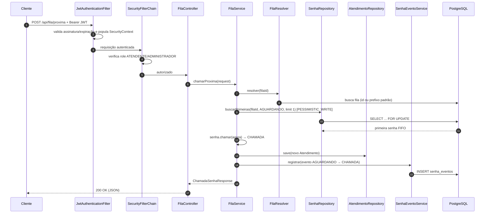

# Arquitetura — Fila de Atendimento

Este documento descreve a organização interna da API, o fluxo de uma requisição, as decisões de projeto e os mecanismos de segurança e concorrência.

---

## 1. Visão geral

A aplicação é um monólito Spring Boot organizado em camadas, com dependências apontando para o domínio:

```
┌──────────────────────────────────────────────────────────────┐
│                        Clientes HTTP                         │
│              (Swagger UI, curl, Postman, frontends)          │
└───────────────────────────────┬──────────────────────────────┘
                                │ HTTPS/JSON + Bearer JWT
┌───────────────────────────────▼──────────────────────────────┐
│  Segurança: JwtAuthenticationFilter → SecurityFilterChain    │
│  (autenticação stateless, autorização por rota e @PreAuthorize)│
└───────────────────────────────┬──────────────────────────────┘
                                │
┌───────────────────────────────▼──────────────────────────────┐
│  Controller  ── DTOs de request/response ── Bean Validation  │
└───────────────────────────────┬──────────────────────────────┘
                                │
┌───────────────────────────────▼──────────────────────────────┐
│  Service  ── regras de negócio, transações, auditoria        │
│            ── Mappers (MapStruct) para converter DTO/Entity  │
└───────────────────────────────┬──────────────────────────────┘
                                │
┌───────────────────────────────▼──────────────────────────────┐
│  Repository (Spring Data JPA + Specifications)               │
└───────────────────────────────┬──────────────────────────────┘
                                │
┌───────────────────────────────▼──────────────────────────────┐
│  PostgreSQL 16  ← migrações Flyway (V1, V2, V3)              │
└──────────────────────────────────────────────────────────────┘
```

### Princípios aplicados

- **Single Responsibility:** controllers só tratam HTTP; services concentram regras; repositories só acessam dados.
- **Open/Closed:** Specifications permitem adicionar filtros sem alterar queries existentes.
- **Dependency Inversion:** services dependem de abstrações de repositório do Spring Data.
- **Tell, Don't Ask:** as entidades `Senha`, `Fila` e `Atendimento` protegem suas invariantes (transições de status, numeração, duração).
- **DTOs:** o contrato HTTP é independente do modelo de persistência.

---

## 2. Pacotes

| Pacote | Responsabilidade |
| --- | --- |
| `config` | `OpenApiConfig`, `CorsProperties`, `FilaProperties`, `JwtProperties`, `TimeConfig` (Clock), `TraceIdFilter` |
| `controller` | `AuthController`, `SenhaController`, `FilaController`, `AtendimentoController`, `FilaAdminController`, `UsuarioController` |
| `dto.request` | Records de entrada com validações Jakarta |
| `dto.response` | Records de saída, incluindo `PageResponse<T>` |
| `entity` | `Fila`, `Senha`, `Atendimento`, `Usuario`, `SenhaEvento`, `AuditableEntity` e enums |
| `exception` | Exceções de domínio + `GlobalExceptionHandler` (RFC 9457) |
| `mapper` | Interfaces MapStruct (`SenhaMapper`, `FilaMapper`, `AtendimentoMapper`, `UsuarioMapper`) |
| `repository` | Interfaces Spring Data + `specification` para filtros dinâmicos |
| `security` | `JwtService`, `JwtAuthenticationFilter`, `SecurityConfig`, `UserDetailsServiceImpl`, handlers REST, `SecurityContextService` |
| `service` | Regras de negócio (`SenhaService`, `FilaService`, `AtendimentoService`, `FilaAdminService`, `UsuarioService`, `AuthService`, `SenhaEventoService`, `FilaResolver`) |
| `util` | `NumeroSenhaUtil` (formatação `A001`), `DuracaoUtil` (cálculo/arredondamento) |

---

## 3. Fluxo de uma requisição

Exemplo: `POST /api/fila/proxima`.



### Tratamento de erros

`GlobalExceptionHandler` converte exceções em `ProblemDetail` (RFC 9457):

| Exceção | HTTP | `codigo` |
| --- | --- | --- |
| `ResourceNotFoundException` | 404 | ex.: `SENHA_NAO_ENCONTRADA` |
| `RegraNegocioException` | 409 | ex.: `FILA_INATIVA` |
| `TransicaoInvalidaException` | 409 | `TRANSICAO_INVALIDA` |
| `MethodArgumentNotValidException` | 400 | `ERRO_VALIDACAO` |
| `AuthenticationException` | 401 | `CREDENCIAIS_INVALIDAS` |
| `AccessDeniedException` | 403 | `ACESSO_NEGADO` |
| `DataIntegrityViolationException` | 409 | `CONFLITO_DADOS` |
| `Exception` | 500 | `ERRO_INTERNO` |

Todas as respostas de erro incluem `timestamp`, `instance`, `traceId` e, quando aplicável, o mapa `erros` por campo.

---

## 4. Decisões de projeto

### 4.1 Numeração diária com concorrência segura (RN001)

A sequência é mantida na própria `Fila` (`ultima_sequencia` + `data_ultima_sequencia`). A emissão ocorre dentro de uma transação que obtém **lock pessimista** na fila:

```java
@Lock(LockModeType.PESSIMISTIC_WRITE)
@Query("select f from Fila f where f.id = :id")
Optional<Fila> findByIdParaAtualizacao(@Param("id") Long id);
```

Assim, duas emissões simultâneas para a mesma fila são serializadas, evitando números duplicados. A restrição única `(fila_id, data_referencia, sequencia)` funciona como última linha de defesa.

`Fila.proximaSequencia(data)` reinicia em `1` quando a data muda:

```java
if (dataReferencia.equals(this.dataUltimaSequencia)) {
    this.ultimaSequencia = this.ultimaSequencia + 1;
} else {
    this.dataUltimaSequencia = dataReferencia;
    this.ultimaSequencia = 1;
}
```

### 4.2 FIFO com lock pessimista (RN002)

`SenhaRepository.buscarPrimeiras` ordena por `dataGeracao` e `sequencia` e usa `PESSIMISTIC_WRITE`. Dois atendentes que chamam ao mesmo tempo não recebem a mesma senha: o segundo aguarda o commit do primeiro e enxerga o novo estado.

### 4.3 Posição na fila sem depender de precisão de timestamp

A posição é calculada por `contarAntes(filaId, status, id)` usando `s.id < :id`. Como o `id` é `IDENTITY` e cresce na ordem de inserção, ele é um critério estável de FIFO mesmo quando dois registros têm o mesmo timestamp (precisão de microssegundos no PostgreSQL/H2).

### 4.4 Atendimento criado na chamada, iniciado depois

- `POST /api/fila/proxima` cria o `Atendimento` com `senha`, `atendente` e `guiche`, mas sem `inicio`.
- `POST /api/atendimentos/iniciar` preenche `inicio` e muda a senha para `EM_ATENDIMENTO`.
- `POST /api/atendimentos/finalizar` preenche `fim`/`observacao` e muda a senha para `ATENDIDA`.

Essa separação permite medir **tempo de espera** (geração → chamada) e **tempo de atendimento** (início → fim) de forma independente.

### 4.5 Trilha de auditoria (RN007)

Cada transição relevante grava um registro em `senha_eventos` com status anterior, novo status, timestamp, usuário responsável e detalhe textual. A gravação ocorre na mesma transação da mudança de estado, garantindo consistência.

### 4.6 Múltiplas filas com prefixo padrão

O sistema suporta várias filas configuráveis (ex.: `A` = Geral, `P` = Prioritária). Quando `filaId` não é informado, `FilaResolver` usa a fila cujo prefixo corresponde a `app.fila.prefixo-padrao` (padrão `A`). Isso simplifica o uso por totens e mantém compatibilidade com o fluxo de fila única.

### 4.7 Numeração e fuso horário

`TimeConfig` expõe um `Clock` baseado em `app.timezone` (`America/Sao_Paulo`). Todos os cálculos de "hoje" usam esse `Clock`, tornando a virada diária previsível e testável (os testes injetam um `Clock.fixed`).

No mesmo `TimeConfig`, o fuso padrão da JVM é alinhado a `app.timezone` no startup (`TimeZone.setDefault`). Isso mantém `@CreationTimestamp`/`@UpdateTimestamp` consistentes com o `Clock` de domínio, especialmente em containers (que por padrão rodam em UTC). Por isso **não** configuramos `hibernate.jdbc.time_zone`: as colunas são `TIMESTAMP` sem fuso e a conversão dupla distorceria os horários. O Compose também define `TZ` no PostgreSQL para que `CURRENT_TIMESTAMP` do seed use o mesmo fuso.

### 4.8 Erros padronizados

O uso de `ProblemDetail` do Spring 6 reduz código repetitivo e entrega um contrato estável, alinhado ao RFC 9457. O `TraceIdFilter` gera/propaga `X-Request-Id` e injeta o valor no MDC, permitindo correlacionar logs e respostas.

---

## 5. Segurança

### 5.1 Autenticação

1. `POST /api/auth/login` recebe e-mail e senha.
2. `AuthenticationManager` delega ao `UserDetailsServiceImpl`, que carrega o usuário e valida a senha BCrypt.
3. `JwtService` gera um token HS256 com `sub` (e-mail), `perfil` e expiração.
4. O cliente envia `Authorization: Bearer <token>`.
5. `JwtAuthenticationFilter` valida o token e popula o `SecurityContext`.
6. `SecurityContextService` recupera o usuário autenticado para auditoria e regras de negócio.

### 5.2 Autorização

- Regras de rota em `SecurityConfig`.
- Regras adicionais com `@PreAuthorize` nos controllers (`ATENDENTE`, `ADMINISTRADOR`).
- `UsuarioController` é integralmente restrito a `ADMINISTRADOR`.
- Um administrador não pode desativar o próprio usuário.

### 5.3 Boas práticas

- Sessões **stateless** (sem cookie de sessão).
- CSRF desabilitado por se tratar de API com token.
- Senhas armazenadas com **BCrypt**.
- CORS configurável por ambiente.
- Stack traces e mensagens internas não são expostas (`server.error.include-*: never`).
- Token com expiração configurável (padrão 2 h).

---

## 6. Persistência e migrações

| Migração | Conteúdo |
| --- | --- |
| `V1__criar_tabelas.sql` | Tabelas `filas`, `usuarios`, `senhas`, `atendimentos`, `senha_eventos`, constraints e checks |
| `V2__criar_indices.sql` | Índices para fila, status, data, histórico e auditoria |
| `V3__dados_iniciais.sql` | Filas `Geral`/`Prioritária` e usuários de demonstração |

- `spring.jpa.hibernate.ddl-auto=validate`: o Hibernate **não** altera o schema; o Flyway é a fonte da verdade.
- `open-in-view=false`: evita consultas implícitas durante a serialização.
- Entidades auditáveis herdam `criadoEm`/`atualizadoEm` de `AuditableEntity`.
- `@Version` em `Fila`, `Senha` e `Usuario` adiciona controle otimista complementar.

---

## 7. Configuração por ambiente

| Arquivo | Uso |
| --- | --- |
| `application.yml` | Configuração padrão, com placeholders `${ENV:default}` |
| `application-dev.yml` | SQL formatado, logs DEBUG e bind de parâmetros |
| `src/test/resources/application-test.yml` | H2 em modo PostgreSQL, segredo JWT de teste, logs reduzidos |

---

## 8. Limitações e evoluções sugeridas

- Não há frontend nem painel visual (escopo da entrega).
- Não há refresh token; o token expira e o usuário precisa autenticar novamente.
- Não há priorização automática por idade/deficiência — a fila prioritária é uma fila separada.
- Rate limiting e observabilidade avançada (Micrometer/Prometheus) podem ser adicionados.
- Para múltiplas instâncias, o lock pessimista no banco continua válido; para escala horizontal, avaliar cache distribuído apenas para leitura.
