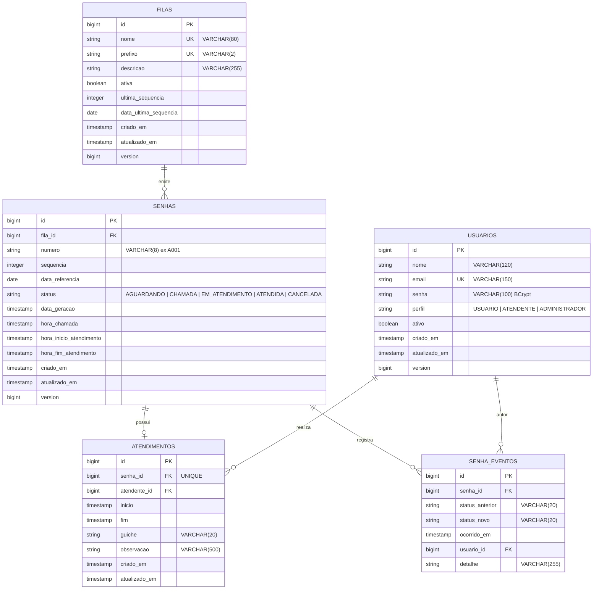
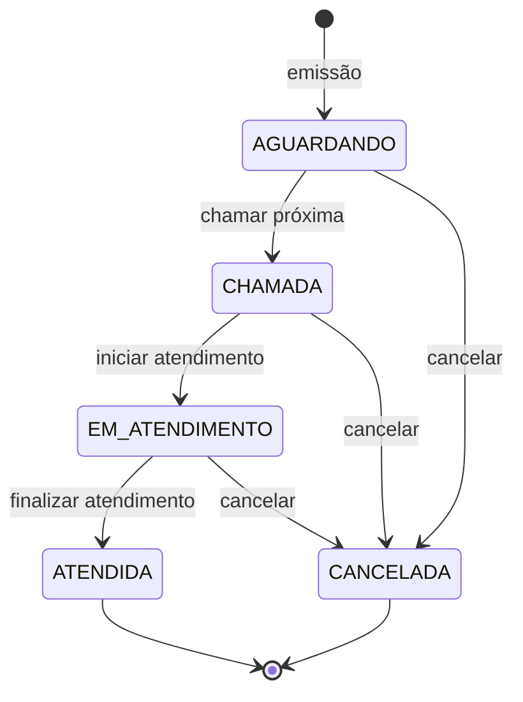

# Modelo de Dados — MER

Banco: **PostgreSQL 16** (scripts compatíveis com H2 em modo PostgreSQL para testes).
Schema gerenciado exclusivamente pelo **Flyway**.

---

## 1. Diagrama entidade-relacionamento



### Cardinalidades

| Relação | Cardinalidade | Observação |
| --- | --- | --- |
| `filas` → `senhas` | 1 : N | Uma fila emite várias senhas |
| `senhas` → `atendimentos` | 1 : 0..1 | `senha_id` é `UNIQUE` (RN004) |
| `usuarios` → `atendimentos` | 1 : N | Atendente responsável (opcional) |
| `senhas` → `senha_eventos` | 1 : N | Trilha de auditoria (RN007) |
| `usuarios` → `senha_eventos` | 1 : N | Autor da transição (opcional) |

---

## 2. Dicionário de dados

### 2.1 `filas`

| Coluna | Tipo | Nulo | Descrição |
| --- | --- | --- | --- |
| `id` | `BIGINT IDENTITY` | não | Chave primária |
| `nome` | `VARCHAR(80)` | não | Nome da fila (único) |
| `prefixo` | `VARCHAR(2)` | não | Letra usada no número da senha (único) |
| `descricao` | `VARCHAR(255)` | sim | Descrição livre |
| `ativa` | `BOOLEAN` | não | Indica se a fila pode emitir/chamar senhas |
| `ultima_sequencia` | `INTEGER` | não | Última sequência emitida |
| `data_ultima_sequencia` | `DATE` | sim | Data da última emissão (controle de reset diário) |
| `criado_em` / `atualizado_em` | `TIMESTAMP` | não | Auditoria temporal |
| `version` | `BIGINT` | não | Controle otimista |

### 2.2 `usuarios`

| Coluna | Tipo | Nulo | Descrição |
| --- | --- | --- | --- |
| `id` | `BIGINT IDENTITY` | não | Chave primária |
| `nome` | `VARCHAR(120)` | não | Nome completo |
| `email` | `VARCHAR(150)` | não | Login (único, case-insensitive na aplicação) |
| `senha` | `VARCHAR(100)` | não | Hash BCrypt |
| `perfil` | `VARCHAR(20)` | não | `USUARIO`, `ATENDENTE` ou `ADMINISTRADOR` |
| `ativo` | `BOOLEAN` | não | Exclusão lógica |
| `criado_em` / `atualizado_em` | `TIMESTAMP` | não | Auditoria temporal |
| `version` | `BIGINT` | não | Controle otimista |

### 2.3 `senhas`

| Coluna | Tipo | Nulo | Descrição |
| --- | --- | --- | --- |
| `id` | `BIGINT IDENTITY` | não | Chave primária; também define a ordem FIFO |
| `fila_id` | `BIGINT` | não | FK → `filas.id` |
| `numero` | `VARCHAR(8)` | não | Ex.: `A001` |
| `sequencia` | `INTEGER` | não | Sequência dentro da fila/dia |
| `data_referencia` | `DATE` | não | Dia da emissão (base do reset) |
| `status` | `VARCHAR(20)` | não | Status atual |
| `data_geracao` | `TIMESTAMP` | não | Momento da emissão |
| `hora_chamada` | `TIMESTAMP` | sim | Momento da chamada |
| `hora_inicio_atendimento` | `TIMESTAMP` | sim | Início efetivo |
| `hora_fim_atendimento` | `TIMESTAMP` | sim | Fim efetivo |
| `criado_em` / `atualizado_em` | `TIMESTAMP` | não | Auditoria temporal |
| `version` | `BIGINT` | não | Controle otimista |

**Constraints relevantes**

- `uq_senhas_fila_data_sequencia` → `(fila_id, data_referencia, sequencia)`
- `uq_senhas_fila_numero_data` → `(fila_id, numero, data_referencia)`
- `ck_senhas_status` → apenas os cinco status válidos

### 2.4 `atendimentos`

| Coluna | Tipo | Nulo | Descrição |
| --- | --- | --- | --- |
| `id` | `BIGINT IDENTITY` | não | Chave primária |
| `senha_id` | `BIGINT` | não | FK → `senhas.id`, **único** |
| `atendente_id` | `BIGINT` | sim | FK → `usuarios.id` |
| `inicio` | `TIMESTAMP` | sim | Preenchido ao iniciar |
| `fim` | `TIMESTAMP` | sim | Preenchido ao finalizar |
| `guiche` | `VARCHAR(20)` | sim | Guichê de atendimento |
| `observacao` | `VARCHAR(500)` | sim | Anotação do atendente |
| `criado_em` / `atualizado_em` | `TIMESTAMP` | não | Auditoria temporal |

### 2.5 `senha_eventos`

| Coluna | Tipo | Nulo | Descrição |
| --- | --- | --- | --- |
| `id` | `BIGINT IDENTITY` | não | Chave primária |
| `senha_id` | `BIGINT` | não | FK → `senhas.id` |
| `status_anterior` | `VARCHAR(20)` | sim | Nulo na criação |
| `status_novo` | `VARCHAR(20)` | não | Status resultante |
| `ocorrido_em` | `TIMESTAMP` | não | Momento do evento |
| `usuario_id` | `BIGINT` | sim | FK → `usuarios.id` |
| `detalhe` | `VARCHAR(255)` | sim | Texto descritivo |

---

## 3. Índices

| Índice | Tabela | Colunas | Objetivo |
| --- | --- | --- | --- |
| `idx_senhas_fila_status_data` | `senhas` | `(fila_id, status, data_geracao)` | Painel e chamada FIFO |
| `idx_senhas_data_referencia` | `senhas` | `(data_referencia)` | Estatísticas e última senha do dia |
| `idx_senhas_status` | `senhas` | `(status)` | Filtros por status |
| `idx_senhas_numero` | `senhas` | `(numero)` | Busca por número |
| `idx_atendimentos_inicio` | `atendimentos` | `(inicio)` | Histórico por período |
| `idx_atendimentos_atendente` | `atendimentos` | `(atendente_id)` | Histórico por atendente |
| `idx_senha_eventos_senha` | `senha_eventos` | `(senha_id, ocorrido_em)` | Consulta da trilha de auditoria |

Além disso, os `UNIQUE` criam índices implícitos em `filas.nome`, `filas.prefixo`, `usuarios.email`, `senhas (fila_id, data_referencia, sequencia)`, `senhas (fila_id, numero, data_referencia)` e `atendimentos.senha_id`.

---

## 4. Transições de status



| De | Para | Gatilho | Regra |
| --- | --- | --- | --- |
| — | `AGUARDANDO` | `POST /api/senhas` | RN001 |
| `AGUARDANDO` | `CHAMADA` | `POST /api/fila/proxima` | RN002/RN003 |
| `CHAMADA` | `EM_ATENDIMENTO` | `POST /api/atendimentos/iniciar` | — |
| `EM_ATENDIMENTO` | `ATENDIDA` | `POST /api/atendimentos/finalizar` | RN005 |
| `AGUARDANDO` / `CHAMADA` / `EM_ATENDIMENTO` | `CANCELADA` | `POST /api/senhas/{id}/cancelar` | RN006 |

`ATENDIDA` e `CANCELADA` são terminais: qualquer tentativa de transição a partir delas lança `TransicaoInvalidaException` (HTTP 409).

Toda transição grava um evento em `senha_eventos` (RN007).

---

## 5. Exemplo de dados

Após a migração `V3`:

```text
filas
┌────┬────────────┬─────────┬──────────────────────────────┬───────┐
│ id │ nome       │ prefixo │ descricao                    │ ativa │
├────┼────────────┼─────────┼──────────────────────────────┼───────┤
│ 1  │ Geral      │ A       │ Fila de atendimento geral    │ true  │
│ 2  │ Prioritaria│ P       │ Fila de atendimento prioritario │ true │
└────┴────────────┴─────────┴──────────────────────────────┴───────┘
```

As senhas de exemplo (`Admin@123`, `Atendente@123`, `Usuario@123`) são armazenadas apenas como hash BCrypt.
