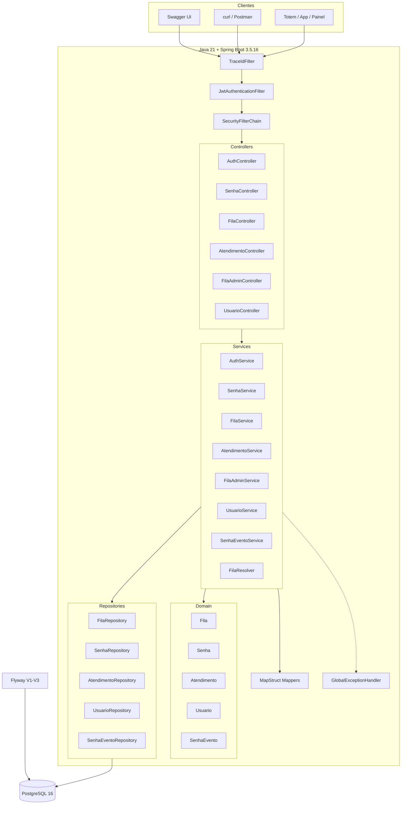
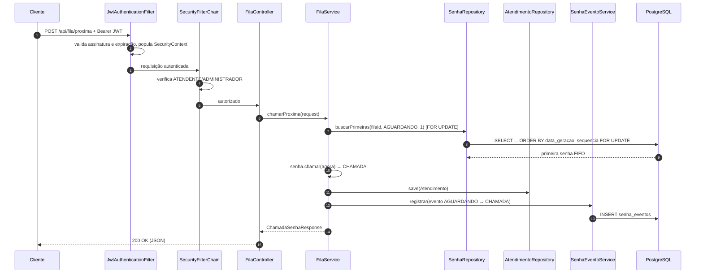
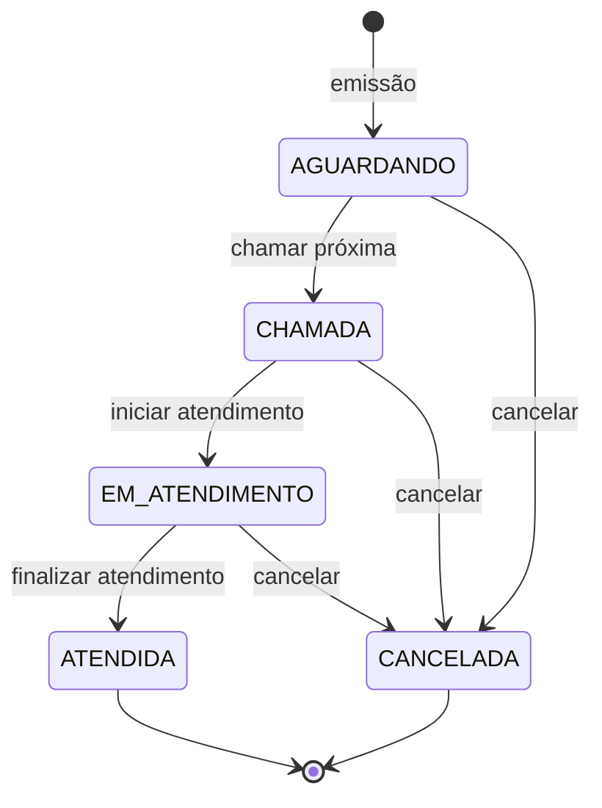
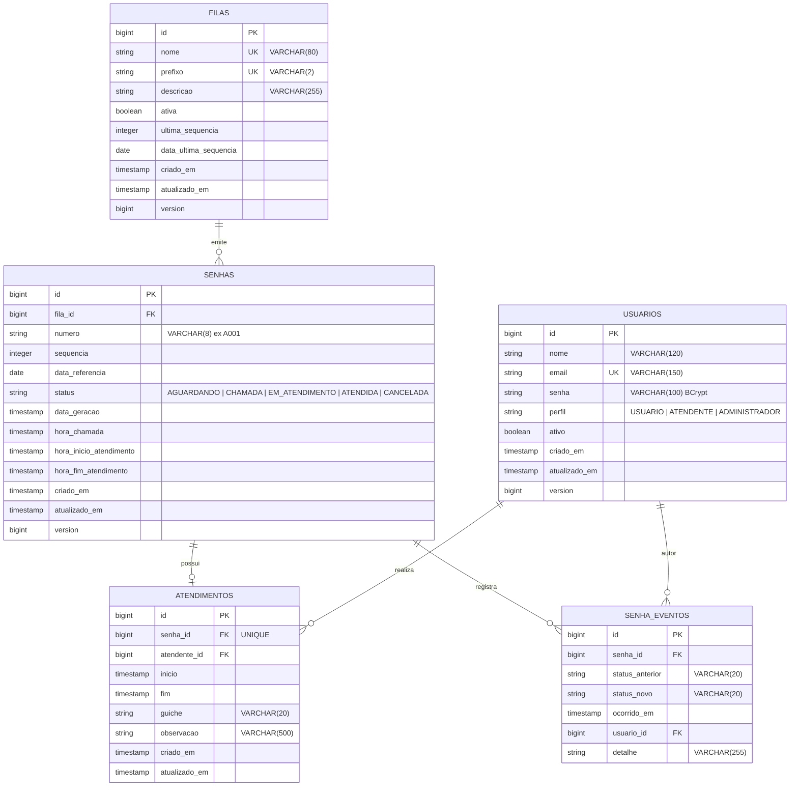

# Relatório Acadêmico — Sistema de Fila de Atendimento

**Curso:** Programa Residência em TIC — Capacita Brasil / iRede
**Projeto:** API de Fila de Atendimento (backend)
**Versão:** 1.0.0
**Stack principal:** Java 21 · Spring Boot 3.5.16 · PostgreSQL 16 · Docker
**Autor:** _(preencher)_
**Orientador:** _(preencher)_
**Data:** 11/11/2026

---

## Sumário

1. [Introdução](#1-introdução)
2. [Objetivo do projeto](#2-objetivo-do-projeto)
3. [Problema resolvido](#3-problema-resolvido)
4. [Escopo e stakeholders](#4-escopo-e-stakeholders)
5. [Tecnologias utilizadas](#5-tecnologias-utilizadas)
6. [Arquitetura do sistema](#6-arquitetura-do-sistema)
7. [Requisitos funcionais](#7-requisitos-funcionais)
8. [Requisitos não funcionais](#8-requisitos-não-funcionais)
9. [Regras de negócio](#9-regras-de-negócio)
10. [Banco de dados](#10-banco-de-dados)
11. [APIs desenvolvidas](#11-apis-desenvolvidas)
12. [Exemplos de requisição e resposta](#12-exemplos-de-requisição-e-resposta)
13. [Classes principais e responsabilidades](#13-classes-principais-e-responsabilidades)
14. [Padrões de projeto, SOLID e Clean Code](#14-padrões-de-projeto-solid-e-clean-code)
15. [Testes realizados](#15-testes-realizados)
16. [Análise crítica](#16-análise-crítica)
17. [Melhorias futuras](#17-melhorias-futuras)
18. [Conclusão](#18-conclusão)
19. [Referências](#19-referências)

---

## 1. Introdução

Filas de atendimento presencial são um problema cotidiano em instituições de ensino, unidades de saúde e órgãos públicos. Quando o controle é manual — senhas de papel, chamadas por nome ou critérios informais — surgem filas duplas, favoritismos, perda de histórico e ausência de indicadores para gestão.

Este projeto implementa o **backend de um sistema de fila de atendimento**, capaz de emitir senhas, organizar a chamada em ordem de chegada, registrar o ciclo completo do atendimento e produzir estatísticas do dia. A solução foi construída com **Java 21 e Spring Boot 3**, seguindo uma organização em camadas inspirada em **Clean Architecture**, princípios **SOLID** e boas práticas de **Clean Code**.

O sistema é **API-only**: todo o contrato é REST/JSON, documentado com OpenAPI/Swagger, autenticado por JWT e persistido em PostgreSQL. O empacotamento é feito com Docker multi-stage e Docker Compose, permitindo execução reproduzível em qualquer máquina com Docker instalado.

---

## 2. Objetivo do projeto

**Objetivo geral:** entregar um MVP funcional, testado e documentado de uma API de gerenciamento de filas de atendimento presencial.

**Objetivos específicos:**

1. Emitir senhas com numeração diária por fila, no formato `PREFIXO + 3 dígitos`.
2. Garantir chamada **FIFO** e consistência sob concorrência.
3. Modelar o ciclo de vida da senha com transições válidas e auditáveis.
4. Registrar atendimentos com guichê, atendente, tempos e observações.
5. Oferecer painel, estatísticas e histórico paginado.
6. Proteger a API com autenticação JWT e autorização por perfis.
7. Demonstrar domínio de Java moderno, Spring Boot, JPA, Flyway, testes automatizados e Docker.
8. Atingir cobertura de testes superior a 80% e documentação técnica completa.

---

## 3. Problema resolvido

| Problema no processo manual | Como o sistema resolve |
| --- | --- |
| Senhas de papel se perdem ou são duplicadas | Numeração persistida e única por fila/dia |
| Chamadas fora de ordem / favorecimento | FIFO garantido por consulta ordenada + lock pessimista |
| Falta de transparência para o cidadão | Consulta de posição e painel em tempo real |
| Nenhum histórico de atendimentos | Tabela `atendimentos` com início, fim, guichê e atendente |
| Impossibilidade de medir eficiência | Estatísticas de tempo médio de espera e atendimento |
| Nenhuma responsabilização | Trilha de auditoria `senha_eventos` com autor e horário |
| Acesso indiscriminado ao sistema | JWT + perfis `USUARIO`, `ATENDENTE` e `ADMINISTRADOR` |
| Ambientes inconsistentes entre máquinas | Docker Compose com healthchecks e Flyway |

**Proposta de valor:** transformar um processo informal em um fluxo digital auditável, mensurável e seguro, com baixo custo de operação e contrato de API reutilizável por totens, aplicativos e painéis.

---

## 4. Escopo e stakeholders

**Stakeholders:** cidadão/aluno (usuário final), atendente, administrador, equipe de TI e gestão institucional.

**No escopo:** emissão de senhas, painel, chamada, cancelamento, início/fim de atendimento, histórico, estatísticas, autenticação, administração de filas/usuários, auditoria e documentação.

**Fora do escopo:** frontend/totem, aplicativo móvel, notificações externas, impressão térmica, integração com catracas, múltiplas unidades (multi-tenant), faturamento e relatórios em PDF.

---

## 5. Tecnologias utilizadas

| Categoria | Tecnologia | Versão | Uso no projeto |
| --- | --- | --- | --- |
| Linguagem | Java | 21 (LTS) | Records, pattern matching, text blocks, `java.time` |
| Framework | Spring Boot | 3.5.16 | Auto-configuração e execução standalone |
| Web | Spring MVC | 6.x | API REST |
| Validação | Jakarta Bean Validation | 3.x | Validação de DTOs |
| Persistência | Spring Data JPA / Hibernate | 6.x | Repositórios, Specifications, locks |
| Banco | PostgreSQL | 16 | Produção e execução Docker |
| Banco de testes | H2 | 2.x | Integração em modo PostgreSQL |
| Migrações | Flyway | 10.x | Versionamento do schema (`V1`–`V3`) |
| Segurança | Spring Security | 6.x | Filtros, RBAC, BCrypt |
| JWT | jjwt | 0.12.6 | Token HS256 |
| Documentação | springdoc-openapi | 2.8.17 | Swagger UI e OpenAPI 3 |
| Mapeamento | MapStruct | 1.6.3 | Entity ↔ DTO em tempo de compilação |
| Boilerplate | Lombok | 1.18.x | Getters, builders, construtores |
| Testes | JUnit 5, Mockito, AssertJ, MockMvc | — | Unitários e integração |
| Cobertura | JaCoCo | 0.8.12 | Gate de 80% de linhas |
| Build | Maven (wrapper) | 3.9 | Build reproduzível |
| Container | Docker + Docker Compose | 29.x / v5.x | Empacotamento e orquestração |
| Observabilidade | Spring Boot Actuator | 3.5.16 | Health e info |

**APIs e integrações:** a aplicação expõe uma API REST própria. Consome apenas o PostgreSQL; não há integrações externas.

---

## 6. Arquitetura do sistema

### 6.1 Estilo arquitetural

Monólito modular Spring Boot em camadas, com dependências apontando para o domínio:

```text
Controller → Service → Repository → Entity
     │           │
     │           ├── Mapper (DTO ↔ Entity)
     │           └── Exception Handler / Security
     └── DTOs de entrada e saída
```

**Decisão:** não foi adotada Clean Architecture “pura” com portas/adaptadores e inversão total de dependências, pois o tamanho do MVP não justifica a cerimônia. A organização mantém os benefícios essenciais: baixo acoplamento, testabilidade e regras de negócio isoladas da infraestrutura.

### 6.2 Diagrama textual da arquitetura

```text
┌─────────────────────────────────────────────────────────────────────────┐
│ CLIENTES                                                                │
│ Swagger UI · curl · Postman · futuros totens, apps e painéis            │
└───────────────────────────────┬─────────────────────────────────────────┘
                                │ HTTP/JSON + Authorization: Bearer <JWT>
┌───────────────────────────────▼─────────────────────────────────────────┐
│ SEGURANÇA (Spring Security)                                             │
│ TraceIdFilter → JwtAuthenticationFilter → SecurityFilterChain           │
│ · autenticação stateless          · autorização por rota e @PreAuthorize│
│ · handlers REST para 401/403 (RFC 9457)                                 │
└───────────────────────────────┬─────────────────────────────────────────┘
                                │
┌───────────────────────────────▼─────────────────────────────────────────┐
│ APRESENTAÇÃO — Controllers                                              │
│ AuthController · SenhaController · FilaController · AtendimentoController│
│ FilaAdminController · UsuarioController                                 │
│ · DTOs de request/response (records)  · Bean Validation                 │
└───────────────────────────────┬─────────────────────────────────────────┘
                                │
┌───────────────────────────────▼─────────────────────────────────────────┐
│ APLICAÇÃO — Services                                                    │
│ AuthService · SenhaService · FilaService · AtendimentoService           │
│ FilaAdminService · UsuarioService · SenhaEventoService · FilaResolver   │
│ · regras de negócio  · transações  · auditoria  · Clock                 │
└───────┬───────────────────────────────────┬─────────────────────────────┘
        │                                   │
┌───────▼───────────────────┐   ┌───────────▼─────────────────────────────┐
│ MAPEAMENTO (MapStruct)    │   │ DOMÍNIO (Entities)                      │
│ SenhaMapper · FilaMapper  │   │ Fila · Senha · Atendimento · Usuario    │
│ AtendimentoMapper · Usuario│  │ SenhaEvento · enums · invariantes       │
└───────────────────────────┘   └───────────┬─────────────────────────────┘
                                            │
┌───────────────────────────────────────────▼─────────────────────────────┐
│ INFRAESTRUTURA — Repositories (Spring Data JPA + Specifications)        │
│ · consultas FIFO com PESSIMISTIC_WRITE                                  │
│ · EntityGraph para evitar N+1  · filtros dinâmicos                      │
└───────────────────────────────┬─────────────────────────────────────────┘
                                │ JDBC
┌───────────────────────────────▼─────────────────────────────────────────┐
│ PostgreSQL 16 — schema gerenciado por Flyway (V1, V2, V3)               │
└─────────────────────────────────────────────────────────────────────────┘
```

### 6.3 Diagrama de componentes (Mermaid)



### 6.4 Fluxo de uma requisição



### 6.5 Decisões arquiteturais relevantes

| Decisão | Justificativa |
| --- | --- |
| **DTOs + MapStruct** | Não expor entidades e desacoplar contrato HTTP do schema; mapeamento em compile-time, sem reflexão. |
| **Lock pessimista em `Fila`** | Serializa emissões simultâneas e evita números duplicados. |
| **Lock pessimista na busca FIFO** | Impede que dois atendentes chamem a mesma senha. |
| **`@Version` nas entidades** | Controle otimista complementar contra atualizações concorrentes. |
| **Atendimento criado na chamada** | Permite medir espera (geração → chamada) e atendimento (início → fim) separadamente. |
| **Flyway + `ddl-auto=validate`** | Schema versionado e reproduzível; Hibernate não altera o banco. |
| **`ProblemDetail` (RFC 9457)** | Contrato de erro padronizado e estável. |
| **`Clock` injetável** | Testes determinísticos da virada diária. |
| **Stateless + JWT** | Escala horizontal sem sessão compartilhada. |

---

## 7. Requisitos funcionais

| ID | Requisito | Endpoint | Ator |
| --- | --- | --- | --- |
| RF001 | Emitir senha | `POST /api/senhas` | USUARIO+ |
| RF002 | Consultar última senha do dia | `GET /api/senhas/ultima` | USUARIO+ |
| RF003 | Consultar painel da fila | `GET /api/fila` | USUARIO+ |
| RF004 | Consultar senha e posição | `GET /api/senhas/{id}` | USUARIO+ |
| RF005 | Consultar estatísticas do dia | `GET /api/fila/estatisticas` | USUARIO+ |
| RF006 | Chamar próxima senha (FIFO) | `POST /api/fila/proxima` | ATENDENTE+ |
| RF007 | Iniciar atendimento | `POST /api/atendimentos/iniciar` | ATENDENTE+ |
| RF008 | Finalizar atendimento | `POST /api/atendimentos/finalizar` | ATENDENTE+ |
| RF009 | Listar senhas com filtros | `GET /api/senhas` | USUARIO+ |
| RF010 | Listar histórico de atendimentos | `GET /api/atendimentos` | ATENDENTE+ |
| RF011 | Consultar atendimento por id | `GET /api/atendimentos/{id}` | ATENDENTE+ |
| RF012 | Cancelar senha | `POST /api/senhas/{id}/cancelar` | ATENDENTE+ |
| RF013 | Autenticar e consultar usuário atual | `POST /api/auth/login` · `GET /api/auth/me` | Público / autenticado |
| RF014 | Administrar filas | `/api/filas/**` | ADMINISTRADOR (escrita) |
| RF015 | Administrar usuários | `/api/usuarios/**` | ADMINISTRADOR |
| RF016 | Auditar transições de status | Persistência interna | Sistema |
| RF017 | Resolver fila padrão por prefixo | Transversal | Sistema |
| RF018 | Suportar múltiplas filas | `/api/filas` | ADMINISTRADOR |

Detalhamento completo, validações e matriz de rastreabilidade: [`REQUISITOS.md`](REQUISITOS.md).

---

## 8. Requisitos não funcionais

| ID | Categoria | Requisito | Evidência |
| --- | --- | --- | --- |
| RNF001 | Tecnologia | Java 21 + Spring Boot 3.5.16 | `pom.xml` |
| RNF002 | Contrato | REST/JSON com OpenAPI 3 | 17 paths no `/v3/api-docs` |
| RNF003 | Segurança | JWT HS256 + BCrypt + RBAC | `SecurityConfig`, testes 401/403 |
| RNF004 | Segurança | Stateless, CORS configurável, sem stack trace | `application.yml` |
| RNF005 | Persistência | PostgreSQL 16 + Flyway + `validate` | Migrações V1–V3 |
| RNF006 | Consistência | Locks + `@Version` + constraints | `PESSIMISTIC_WRITE`, `uq_*` |
| RNF007 | Desempenho | Paginação 20/100 e índices | `V2__criar_indices.sql` |
| RNF008 | Disponibilidade | Healthchecks de API e banco | `docker compose ps` → healthy |
| RNF009 | Portabilidade | Docker multi-stage + Compose | `Dockerfile`, `docker-compose.yml` |
| RNF010 | Qualidade | Cobertura mínima de 80% | JaCoCo: **93,3%** de linhas |
| RNF011 | Testabilidade | 120 testes unitários e de integração | `mvn verify` |
| RNF012 | Observabilidade | Actuator + `X-Request-Id`/MDC | `TraceIdFilter`, `/actuator/health` |
| RNF013 | Manutenibilidade | Camadas, DTOs, mappers, SOLID | estrutura de pacotes |
| RNF014 | Usabilidade | Erros RFC 9457 com `codigo` e `traceId` | `GlobalExceptionHandler` |
| RNF015 | Fuso horário | `APP_TIMEZONE` consistente | `TimeConfig` + `TZ` no Compose |
| RNF016 | Documentação | README + 5 documentos técnicos + Postman | pasta `docs/` |
| RNF017 | Configuração | Segredos por variáveis de ambiente | `.env.example` |

---

## 9. Regras de negócio

| ID | Regra |
| --- | --- |
| RN001 | Numeração sequencial por fila, reiniciada diariamente, formato `PREFIXO` + 3 dígitos (`A001`). |
| RN002 | Chamada estritamente FIFO (menor `dataGeracao`/`sequencia`). |
| RN003 | Apenas senhas `AGUARDANDO` podem ser chamadas. |
| RN004 | Cada senha possui no máximo um atendimento. |
| RN005 | Só é possível finalizar atendimento já iniciado; ao finalizar, a senha vira `ATENDIDA`. |
| RN006 | Cancelamento é definitivo; a senha não retorna à fila. |
| RN007 | Toda transição de status é auditada em `senha_eventos`. |
| RN008 | Fila inativa não emite nem chama senhas. |
| RN009 | Administrador não pode desativar a própria conta. |
| RN010 | Exclusões de fila e usuário são lógicas, preservando o histórico. |
| RN011 | Senha cancelada não pode ser chamada novamente. |
| RN012 | E-mail, nome de fila e prefixo são únicos. |

### 9.1 Ciclo de vida da senha



As transições são validadas **dentro das entidades** (`Senha.chamar`, `Senha.iniciarAtendimento`, `Senha.finalizarAtendimento`, `Senha.cancelar`), que lançam `TransicaoInvalidaException` (HTTP 409) quando a operação é inválida. Isso caracteriza o padrão **Tell, Don't Ask** e protege as invariantes do domínio.

---

## 10. Banco de dados

### 10.1 Visão geral

- **SGBD:** PostgreSQL 16 (H2 em modo PostgreSQL nos testes).
- **Schema:** criado exclusivamente por Flyway.
- **Migrações:** `V1__criar_tabelas.sql`, `V2__criar_indices.sql`, `V3__dados_iniciais.sql`.
- **Auditoria:** `criado_em`/`atualizado_em` via `AuditableEntity`; `version` para controle otimista.

### 10.2 DER (Mermaid)



### 10.3 Dicionário resumido

| Tabela | Papel | Principais constraints |
| --- | --- | --- |
| `filas` | Filas configuráveis, com controle da sequência diária | `UNIQUE(nome)`, `UNIQUE(prefixo)` |
| `usuarios` | Operadores e cidadãos, com perfil e exclusão lógica | `UNIQUE(email)`, `CHECK(perfil)` |
| `senhas` | Senhas emitidas e seu ciclo de vida | `UNIQUE(fila_id, data_referencia, sequencia)`, `UNIQUE(fila_id, numero, data_referencia)`, `CHECK(status)` |
| `atendimentos` | Execução do atendimento (1:1 com senha) | `UNIQUE(senha_id)`, FKs |
| `senha_eventos` | Trilha de auditoria das transições | FKs, índice `(senha_id, ocorrido_em)` |

### 10.4 Índices

| Índice | Colunas | Objetivo |
| --- | --- | --- |
| `idx_senhas_fila_status_data` | `(fila_id, status, data_geracao)` | Painel e chamada FIFO |
| `idx_senhas_data_referencia` | `(data_referencia)` | Estatísticas e última senha |
| `idx_senhas_status` | `(status)` | Filtros por status |
| `idx_senhas_numero` | `(numero)` | Busca por número |
| `idx_atendimentos_inicio` | `(inicio)` | Histórico por período |
| `idx_atendimentos_atendente` | `(atendente_id)` | Histórico por atendente |
| `idx_senha_eventos_senha` | `(senha_id, ocorrido_em)` | Consulta da auditoria |

Dicionário completo e exemplos: [`MER.md`](MER.md).

---

## 11. APIs desenvolvidas

### 11.1 Convenções

- Base: `http://localhost:8080`
- Formato: JSON (`application/json`)
- Autenticação: `Authorization: Bearer <token>` (exceto login)
- Erros: `application/problem+json` (RFC 9457)
- Paginação: `?page=0&size=20&sort=campo,asc|desc`

### 11.2 Endpoints (24 operações em 17 paths)

#### Autenticação

| Método | Rota | Acesso | Descrição | Sucesso |
| --- | --- | --- | --- | --- |
| POST | `/api/auth/login` | Público | Autentica e retorna JWT | 200 |
| GET | `/api/auth/me` | Autenticado | Dados do usuário atual | 200 |

#### Senhas

| Método | Rota | Acesso | Descrição | Sucesso |
| --- | --- | --- | --- | --- |
| POST | `/api/senhas` | Autenticado | Emite senha | 201 + `Location` |
| GET | `/api/senhas` | Autenticado | Lista com filtros (`status`, `filaId`, `data`, paginação) | 200 |
| GET | `/api/senhas/ultima` | Autenticado | Última senha do dia | 200 |
| GET | `/api/senhas/{id}` | Autenticado | Senha + posição | 200 |
| POST | `/api/senhas/{id}/cancelar` | ATENDENTE/ADMIN | Cancela senha | 200 |

#### Fila

| Método | Rota | Acesso | Descrição | Sucesso |
| --- | --- | --- | --- | --- |
| GET | `/api/fila` | Autenticado | Painel (aguardando, chamadas, em atendimento) | 200 |
| GET | `/api/fila/estatisticas` | Autenticado | Estatísticas do dia | 200 |
| POST | `/api/fila/proxima` | ATENDENTE/ADMIN | Chama a próxima (FIFO) | 200 |

#### Atendimentos

| Método | Rota | Acesso | Descrição | Sucesso |
| --- | --- | --- | --- | --- |
| POST | `/api/atendimentos/iniciar` | ATENDENTE/ADMIN | Inicia atendimento | 200 |
| POST | `/api/atendimentos/finalizar` | ATENDENTE/ADMIN | Finaliza atendimento | 200 |
| GET | `/api/atendimentos` | ATENDENTE/ADMIN | Histórico paginado | 200 |
| GET | `/api/atendimentos/{id}` | ATENDENTE/ADMIN | Atendimento por id | 200 |

#### Filas (administração)

| Método | Rota | Acesso | Descrição | Sucesso |
| --- | --- | --- | --- | --- |
| GET | `/api/filas` | Autenticado | Lista filas | 200 |
| GET | `/api/filas/{id}` | Autenticado | Fila por id | 200 |
| POST | `/api/filas` | ADMIN | Cria fila | 201 |
| PUT | `/api/filas/{id}` | ADMIN | Atualiza fila | 200 |
| DELETE | `/api/filas/{id}` | ADMIN | Desativa fila | 204 |

#### Usuários

| Método | Rota | Acesso | Descrição | Sucesso |
| --- | --- | --- | --- | --- |
| GET | `/api/usuarios` | ADMIN | Lista paginada | 200 |
| GET | `/api/usuarios/{id}` | ADMIN | Usuário por id | 200 |
| POST | `/api/usuarios` | ADMIN | Cria usuário | 201 |
| PUT | `/api/usuarios/{id}` | ADMIN | Atualiza usuário | 200 |
| DELETE | `/api/usuarios/{id}` | ADMIN | Desativa usuário | 204 |

### 11.3 Códigos de erro

| HTTP | Situação | `codigo` |
| --- | --- | --- |
| 400 | Payload/parâmetro inválido | `ERRO_VALIDACAO` / `REQUISICAO_INVALIDA` |
| 401 | Token ausente, inválido ou credenciais erradas | `CREDENCIAIS_INVALIDAS` |
| 403 | Perfil sem permissão | `ACESSO_NEGADO` |
| 404 | Recurso inexistente | ex.: `SENHA_NAO_ENCONTRADA` |
| 409 | Regra de negócio / transição inválida / conflito | ex.: `FILA_INATIVA`, `TRANSICAO_INVALIDA` |
| 500 | Erro inesperado | `ERRO_INTERNO` |

Referência completa: [`API.md`](API.md) e Swagger UI.

---

## 12. Exemplos de requisição e resposta

### 12.1 Login

```http
POST /api/auth/login
Content-Type: application/json

{
  "email": "atendente@fila.local",
  "senha": "Atendente@123"
}
```

```json
{
  "token": "eyJhbGciOiJIUzI1NiJ9...",
  "tipo": "Bearer",
  "expiraEmSegundos": 7200,
  "usuario": {
    "id": 2,
    "nome": "Atendente Padrao",
    "email": "atendente@fila.local",
    "perfil": "ATENDENTE",
    "ativo": true,
    "criadoEm": "2026-11-11T12:06:49.668478"
  }
}
```

### 12.2 Emitir senha

```http
POST /api/senhas
Authorization: Bearer <token>
Content-Type: application/json

{ "filaId": 1 }
```

```http
HTTP/1.1 201 Created
Location: http://localhost:8080/api/senhas/1
```

```json
{
  "id": 1,
  "numero": "A001",
  "status": "AGUARDANDO",
  "fila": { "id": 1, "nome": "Geral", "prefixo": "A" },
  "dataGeracao": "2026-11-11T12:08:00.545123",
  "posicao": 1,
  "pessoasNaFrente": 0
}
```

### 12.3 Painel da fila

```http
GET /api/fila?filaId=1
Authorization: Bearer <token>
```

```json
{
  "fila": { "id": 1, "nome": "Geral", "prefixo": "A" },
  "aguardando": [
    {
      "id": 1,
      "numero": "A001",
      "status": "AGUARDANDO",
      "dataGeracao": "2026-11-11T12:08:00.545123",
      "horaChamada": null,
      "horaInicioAtendimento": null
    }
  ],
  "chamadas": [],
  "emAtendimento": [],
  "totalAguardando": 1,
  "atualizadoEm": "2026-11-11T12:08:01"
}
```

### 12.4 Chamar a próxima

```http
POST /api/fila/proxima
Authorization: Bearer <token>
Content-Type: application/json

{ "filaId": 1, "guiche": "G1" }
```

```json
{
  "senhaId": 1,
  "numero": "A001",
  "status": "CHAMADA",
  "horaChamada": "2026-11-11T12:08:05.471856",
  "atendimentoId": 1,
  "guiche": "G1",
  "aguardandoRestantes": 0
}
```

### 12.5 Iniciar atendimento

```http
POST /api/atendimentos/iniciar
Authorization: Bearer <token>
Content-Type: application/json

{ "senhaId": 1, "guiche": "G1" }
```

```json
{
  "id": 1,
  "senhaId": 1,
  "numeroSenha": "A001",
  "statusSenha": "EM_ATENDIMENTO",
  "inicio": "2026-11-11T12:08:05.846971",
  "fim": null,
  "guiche": "G1",
  "observacao": null,
  "atendenteId": 2,
  "atendenteNome": "Atendente Padrao",
  "duracaoSegundos": null
}
```

### 12.6 Finalizar atendimento

```http
POST /api/atendimentos/finalizar
Authorization: Bearer <token>
Content-Type: application/json

{ "atendimentoId": 1, "observacao": "Atendimento concluído" }
```

```json
{
  "id": 1,
  "senhaId": 1,
  "numeroSenha": "A001",
  "statusSenha": "ATENDIDA",
  "inicio": "2026-11-11T12:08:05.846971",
  "fim": "2026-11-11T12:08:06.051292",
  "guiche": "G1",
  "observacao": "Smoke test",
  "atendenteId": 2,
  "atendenteNome": "Atendente Padrao",
  "duracaoSegundos": 0
}
```

### 12.7 Estatísticas

```http
GET /api/fila/estatisticas?filaId=1
Authorization: Bearer <token>
```

```json
{
  "data": "2026-11-11",
  "totalEmitidas": 1,
  "aguardando": 0,
  "chamadas": 0,
  "emAtendimento": 0,
  "atendidas": 1,
  "canceladas": 0,
  "tempoMedioEsperaSegundos": 4.0,
  "tempoMedioAtendimentoSegundos": 0.0,
  "ultimaSenhaEmitida": "A001",
  "ultimaSenhaChamada": "A001"
}
```

### 12.8 Erros

**Transição inválida (409):**

```json
{
  "type": "about:blank",
  "title": "Regra de negocio violada",
  "status": 409,
  "detail": "Nao e possivel iniciar o atendimento de a senha A001: status atual AGUARDANDO, status esperado CHAMADA.",
  "instance": "/api/atendimentos/iniciar",
  "codigo": "TRANSICAO_INVALIDA",
  "timestamp": "2026-11-11T12:10:00",
  "traceId": "9f3c1a2b"
}
```

**Sem token (401):**

```json
{
  "type": "about:blank",
  "title": "Nao autenticado",
  "status": 401,
  "detail": "Autenticacao necessaria para acessar este recurso.",
  "instance": "/api/usuarios",
  "codigo": "NAO_AUTENTICADO",
  "timestamp": "2026-11-11T12:10:00",
  "traceId": "9f3c1a2b"
}
```

**Validação (400):**

```json
{
  "type": "about:blank",
  "title": "Erro de validacao",
  "status": 400,
  "detail": "Um ou mais campos estao invalidos.",
  "instance": "/api/usuarios",
  "codigo": "ERRO_VALIDACAO",
  "erros": {
    "email": "E-mail invalido",
    "senha": "A senha deve ter entre 8 e 72 caracteres"
  },
  "timestamp": "2026-11-11T12:10:00",
  "traceId": "9f3c1a2b"
}
```

---

## 13. Classes principais e responsabilidades

### 13.1 Configuração (`config`)

| Classe | Responsabilidade |
| --- | --- |
| `OpenApiConfig` | Define título, versão, contato e esquema `bearerAuth` do Swagger. |
| `CorsProperties` | Mapeia `app.cors.allowed-origins`. |
| `FilaProperties` | Mapeia `app.fila.prefixo-padrao`. |
| `JwtProperties` | Mapeia segredo, expiração e emissor do JWT. |
| `TimeConfig` | Expõe `Clock` no fuso da aplicação e alinha o fuso padrão da JVM. |
| `TraceIdFilter` | Gera/propaga `X-Request-Id` e injeta no MDC. |

### 13.2 Controllers

| Classe | Responsabilidade |
| --- | --- |
| `AuthController` | Login e dados do usuário autenticado. |
| `SenhaController` | Emissão, consulta, listagem, última senha e cancelamento. |
| `FilaController` | Painel, estatísticas e chamada da próxima senha. |
| `AtendimentoController` | Início, fim, histórico e consulta de atendimentos. |
| `FilaAdminController` | CRUD administrativo de filas. |
| `UsuarioController` | CRUD administrativo de usuários (somente ADMIN). |

### 13.3 Serviços

| Classe | Responsabilidade |
| --- | --- |
| `AuthService` | Autentica via `AuthenticationManager` e emite token. |
| `SenhaService` | Emissão com numeração diária/lock, consulta de posição, listagem e cancelamento. |
| `FilaService` | Painel, estatísticas e chamada FIFO com criação do atendimento. |
| `AtendimentoService` | Início/fim do atendimento, histórico e consulta. |
| `FilaAdminService` | Criação/atualização/desativação de filas com validação de unicidade. |
| `UsuarioService` | CRUD de usuários, hash BCrypt e regra de autodesativação. |
| `SenhaEventoService` | Registro da trilha de auditoria. |
| `FilaResolver` | Resolve a fila por id ou pelo prefixo padrão. |

### 13.4 Domínio (`entity`)

| Classe | Responsabilidade |
| --- | --- |
| `Fila` | Guarda sequência diária (`proximaSequencia`) e dados da fila. |
| `Senha` | Ciclo de vida e transições válidas; posição e status. |
| `Atendimento` | Início/fim, guichê, observação e duração. |
| `Usuario` | Dados de autenticação, perfil e exclusão lógica. |
| `SenhaEvento` | Registro imutável de transição de status. |
| `AuditableEntity` | `criadoEm`/`atualizadoEm` com `@CreationTimestamp`/`@UpdateTimestamp`. |
| `StatusSenha` | Enum com estados e `isTerminal()`. |
| `PerfilUsuario` | Enum de perfis de acesso. |

### 13.5 Repositórios e Specifications

| Classe | Responsabilidade |
| --- | --- |
| `FilaRepository` | Busca por prefixo, unicidade e lock pessimista. |
| `SenhaRepository` | FIFO com lock, contagem por status, posição, última do dia e filtros. |
| `AtendimentoRepository` | EntityGraph para senha/atendente e filtros dinâmicos. |
| `UsuarioRepository` | Busca por e-mail e usuários ativos. |
| `SenhaEventoRepository` | Eventos por senha em ordem cronológica. |
| `SenhaSpecification` | Filtros combináveis de senhas. |
| `AtendimentoSpecification` | Filtros combináveis de atendimentos. |

### 13.6 Segurança

| Classe | Responsabilidade |
| --- | --- |
| `SecurityConfig` | Filter chain, regras de rota, CORS, BCrypt e `AuthenticationManager`. |
| `JwtService` | Geração/validação de token HS256. |
| `JwtAuthenticationFilter` | Extrai e valida o Bearer token por requisição. |
| `UserDetailsServiceImpl` | Carrega usuário ativo para autenticação. |
| `SecurityContextService` | Recupera o usuário autenticado para regras e auditoria. |
| `RestAuthenticationEntryPoint` | Resposta 401 em RFC 9457. |
| `RestAccessDeniedHandler` | Resposta 403 em RFC 9457. |

### 13.7 DTOs, mappers e utilitários

| Grupo | Classes |
| --- | --- |
| Requests (8) | `LoginRequest`, `CriarSenhaRequest`, `ChamarProximaRequest`, `IniciarAtendimentoRequest`, `FinalizarAtendimentoRequest`, `FilaRequest`, `CriarUsuarioRequest`, `AtualizarUsuarioRequest` |
| Responses (11) | `LoginResponse`, `SenhaResponse`, `SenhaPainelResponse`, `FilaResponse`, `FilaResumoResponse`, `FilaDetalheResponse`, `ChamadaSenhaResponse`, `AtendimentoResponse`, `EstatisticasResponse`, `UsuarioResponse`, `PageResponse<T>` |
| Mappers (4) | `SenhaMapper`, `FilaMapper`, `AtendimentoMapper`, `UsuarioMapper` |
| Utils (2) | `NumeroSenhaUtil` (formata `A001`), `DuracaoUtil` (cálculo/arredondamento) |
| Exceções (4 + handler) | `ResourceNotFoundException`, `RegraNegocioException`, `TransicaoInvalidaException`, `FilaVaziaException`, `GlobalExceptionHandler` |

**Total:** 73 arquivos Java de produção e 20 arquivos de teste (2.518 + 2.026 linhas).

---

## 14. Padrões de projeto, SOLID e Clean Code

### 14.1 Padrões e estilos arquiteturais

| Padrão | Onde aparece |
| --- | --- |
| **Layered Architecture** | `controller` → `service` → `repository` → `entity` |
| **DTO / Mapper** | Records de request/response + MapStruct |
| **Repository** | Interfaces Spring Data JPA |
| **Service Layer** | Regras de negócio transacionais |
| **Dependency Injection** | Construtores via Lombok `@RequiredArgsConstructor` |
| **Specification** | `SenhaSpecification`, `AtendimentoSpecification` |
| **Template Method** | `JpaRepository` / `OncePerRequestFilter` |
| **Chain of Responsibility** | Filtros do Spring Security |
| **Front Controller** | `DispatcherServlet` |
| **Exception Handler global** | `@RestControllerAdvice` |
| **Value Object / Enum** | `StatusSenha`, `PerfilUsuario` |
| **Builder** | Lombok `@Builder` nas entidades |

### 14.2 Princípios SOLID

| Princípio | Aplicação |
| --- | --- |
| **S — Single Responsibility** | Controllers só HTTP; services só regras; repositórios só dados; um mapper por agregado. |
| **O — Open/Closed** | Novos filtros entram como `Specification` sem alterar consultas existentes. |
| **L — Liskov** | `AuditableEntity` é substituível pelas entidades; `UserDetailsService` segue o contrato do Spring. |
| **I — Interface Segregation** | Repositórios específicos por agregado; DTOs enxutos por caso de uso. |
| **D — Dependency Inversion** | Services dependem de interfaces de repositório e de `Clock`, não de implementações concretas. |

### 14.3 Clean Code

- **Nomes intencionais:** `buscarPrimeiras`, `contarAntes`, `proximaSequencia`, `exigirUsuarioAtual`.
- **Métodos pequenos e coesos:** cada service tem uma responsabilidade clara.
- **Tell, Don't Ask:** entidades validam suas próprias transições (`Senha.chamar` etc.).
- **Fail fast:** validações de payload + exceções específicas de domínio.
- **Sem números mágicos:** `NumeroSenhaUtil` centraliza o formato; `DuracaoUtil` centraliza arredondamento.
- **Constantes e configuração externa:** `TRACE_ID`, `HEADER`, `app.*` e variáveis de ambiente.
- **Tratamento de erros centralizado:** nenhum `try/catch` repetido nos controllers.
- **Comentários apenas onde agrega:** Javadoc curto em regras e decisões não óbvias.
- **Sem duplicação de mapeamento:** MapStruct gera o código em compile-time.
- **Testes legíveis:** nomes no formato `deveXQuandoY`, uso de builders e AssertJ.

### 14.4 Evidências de boas práticas de engenharia

- `open-in-view=false` evita consultas implícitas na serialização.
- `EntityGraph` previne N+1 em atendimentos e senhas.
- `@Version` + locks cobrem concorrência otimista e pessimista.
- `ProblemDetail` alinhado ao RFC 9457.
- JaCoCo com gate de 80% no `verify`.
- Docker multi-stage com usuário não-root e healthchecks.
- `.env.example` + placeholders, sem segredos versionados.
- Fuso horário consistente entre JVM, banco e container.

---

## 15. Testes realizados

### 15.1 Estratégia

Pirâmide de testes com predominância de testes unitários e uma camada relevante de integração:

| Nível | Ferramentas | Objetivo |
| --- | --- | --- |
| Unitário | JUnit 5, Mockito, AssertJ | Regras de entidade, services, mappers, JWT e utilitários |
| Integração | `@SpringBootTest`, MockMvc, H2 | Contrato HTTP, segurança, validação, Flyway e OpenAPI |

Testes de integração usam **H2 em modo PostgreSQL** com as mesmas migrações Flyway, garantindo aderência ao schema real.

### 15.2 Resultado da execução

```text
Tests run: 120, Failures: 0, Errors: 0, Skipped: 0
All coverage checks have been met.
BUILD SUCCESS
```

**Cobertura (relatório JaCoCo completo):**

| Métrica | Resultado |
| --- | --- |
| Linhas | **93,3%** (725 de 777) |
| Branches | 70,6% (137 de 194) |
| Gate de linhas | ≥ 80% **atendido** |

**Cobertura por pacote (linhas):**

| Pacote | Cobertura |
| --- | --- |
| `dto.request` / `dto.response` | 100% |
| `security` | 99,1% |
| `service` | 99,2% |
| `controller` | 97,7% |
| `mapper` | 93,1% |
| `entity` | 87,5% |
| `util` | 90,9% |
| `repository.specification` | 73,9% |
| `exception` | 60,3% |

### 15.3 Suítes

| Suíte | Testes |
| --- | --- |
| `ContextIntegrationTest` | 1 |
| `AuthControllerIntegrationTest` | 8 |
| `FilaAdminControllerIntegrationTest` | 5 |
| `FilaControllerIntegrationTest` | 4 |
| `OpenApiIntegrationTest` | 2 |
| `SenhaControllerIntegrationTest` | 11 |
| `UsuarioControllerIntegrationTest` | 7 |
| `FilaTest` | 3 |
| `SenhaTest` | 11 |
| `MapperTest` | 6 |
| `JwtServiceTest` | 5 |
| `UserDetailsServiceImplTest` | 3 |
| `AtendimentoServiceTest` | 10 |
| `AuthServiceTest` | 4 |
| `FilaAdminServiceTest` | 9 |
| `FilaServiceTest` | 7 |
| `SenhaServiceTest` | 11 |
| `UsuarioServiceTest` | 10 |
| `NumeroSenhaUtilTest` | 3 |
| **Total** | **120** |

### 15.4 Testes manuais e de aceitação

Além da suíte automatizada, foi executado um **smoke test end-to-end** contra a stack Docker real:

1. Login como atendente.
2. Emissão de senha (`A001`).
3. Consulta de posição.
4. Painel da fila.
5. Chamada da próxima senha.
6. Início do atendimento.
7. Finalização (`ATENDIDA`, duração calculada).
8. Estatísticas e histórico.
9. Validação de segurança (401 sem token; 403 para perfil sem permissão).
10. Validação do Swagger e da consistência dos horários no banco.

Detalhes: [`TESTES.md`](TESTES.md).

---

## 16. Análise crítica

### 16.1 Pontos fortes

1. **Domínio rico e coeso:** as entidades protegem invariantes e o ciclo de vida é explícito.
2. **Consistência sob concorrência:** locks pessimistas + constraints únicas + `@Version` cobrem os cenários críticos (emissão e chamada).
3. **Contrato de API profissional:** DTOs, validação, paginação, códigos de erro RFC 9457 e OpenAPI.
4. **Segurança adequada ao MVP:** stateless, BCrypt, RBAC em rota e método, sem exposição de stack trace.
5. **Qualidade mensurável:** 120 testes e 93,3% de cobertura de linhas com gate de build.
6. **Reprodutibilidade:** Docker multi-stage, healthchecks, Flyway e variáveis de ambiente.
7. **Documentação acima da média:** README, arquitetura, MER, API, testes, Postman e relatório.
8. **Decisões justificadas:** cada mecanismo relevante (lock, auditoria, Clock, `open-in-view`) tem racional documentado.

### 16.2 Limitações e trade-offs

| Limitação | Impacto | Observação |
| --- | --- | --- |
| Sem frontend/totem | Demonstração depende de Swagger/curl | Fora do escopo aprovado |
| Estatísticas carregam as senhas do dia em memória | Custo cresce com volume diário | Aceitável no MVP; pode virar agregação SQL |
| Auditoria não exposta via API | Dados existem, mas não há consulta | Evolução simples (endpoint somente leitura) |
| H2 nos testes em vez de Testcontainers | Pequena divergência de dialeto | Migrações reduzem o risco |
| Sem refresh token/revogação | Sessão expira em 2 h | Trade-off de simplicidade |
| Sem rate limiting | Vulnerável a abuso de login | Resolver com Bucket4j/gateway |
| `JWT_SECRET` com default no YAML | Risco se esquecido em produção | Documentado; ideal é falhar sem variável |
| Sem versionamento de API (`/v1`) | Evolução quebra compatibilidade | Baixo custo para adicionar |
| Cobertura de branches (70,6%) menor que linhas | Caminhos alternativos menos testados | Foco em `exception` (60,3%) |
| Sem CI/CD | Verificação depende do ambiente local | GitHub Actions resolveria |

### 16.3 Riscos técnicos

- **Concorrência:** o lock pessimista resolve, mas pode gerar contenção em picos; monitorar tempo de espera.
- **Crescimento das tabelas:** `senhas` e `senha_eventos` crescem diariamente; planejar política de retenção/particionamento.
- **Segredo JWT:** rotação e armazenamento seguro são essenciais em produção.
- **Fuso horário:** já corrigido e documentado; qualquer mudança deve manter `Clock`, JVM e banco alinhados.

### 16.4 Autoavaliação acadêmica

| Critério típico | Evidência no projeto |
| --- | --- |
| Domínio da linguagem | Java 21 com records, enums ricos, `java.time`, text blocks |
| Framework | Spring Boot 3 completo (Web, Data, Security, Validation, Actuator) |
| Persistência | JPA, consultas derivadas, JPQL, Specifications, locks, Flyway |
| Boas práticas | SOLID, DTOs, MapStruct, tratamento global de erros, logs |
| Testes | 120 testes, integração com MockMvc, cobertura 93,3% |
| DevOps | Docker multi-stage, Compose, healthchecks, variáveis de ambiente |
| Documentação | 8 documentos técnicos + coleção Postman |

### 16.5 Perguntas prováveis da banca (e respostas curtas)

1. **Por que lock pessimista e não otimista?** Porque a operação é curta e crítica; o pessimista evita retrabalho e duplicidade de números/chamadas. O `@Version` cobre o restante.
2. **Por que o atendimento é criado na chamada?** Para separar tempo de espera (geração → chamada) do tempo de atendimento (início → fim).
3. **Por que não Clean Architecture completa?** O MVP não justifica o custo; a separação em camadas entrega os mesmos benefícios com menos cerimônia.
4. **Como a numeração reinicia?** `Fila.proximaSequencia` compara `dataReferencia` com `dataUltimaSequencia` e volta a 1 na virada do dia.
5. **Como evitar chamar a mesma senha duas vezes?** `buscarPrimeiras` com `PESSIMISTIC_WRITE` + transição validada na entidade.
6. **O que acontece se o token expirar?** A requisição recebe 401 e o cliente precisa autenticar novamente.
7. **Como garantem que o schema está correto?** Flyway versiona e `ddl-auto=validate` falha se a entidade divergir do banco.
8. **Qual a estratégia de testes?** Unitários para regras e integração para contrato/segurança, com H2 em modo PostgreSQL.

---

## 17. Melhorias futuras

### Curto prazo (alto impacto, baixo esforço)

1. Endpoint de consulta da trilha de auditoria (`GET /api/senhas/{id}/eventos`).
2. `springdoc` com exemplos e descrições de erro por endpoint.
3. Validação de `JWT_SECRET` forte no startup (fail fast em produção).
4. Testes de `GlobalExceptionHandler` para elevar a cobertura de branches.
5. Pipeline CI (GitHub Actions) com `mvn verify` e build da imagem.

### Médio prazo

6. **Testcontainers** com PostgreSQL real nos testes de integração.
7. **Refresh token** + revogação/blacklist e endpoint de logout.
8. **Rate limiting** no login e nos endpoints públicos.
9. **Versionamento de API** (`/api/v1`) e política de depreciação.
10. **Agregações SQL** para estatísticas, removendo o carregamento em memória.
11. **Frontend** (React/Vue) com painel de TV e totem de emissão.
12. **SSE/WebSocket** para atualização do painel em tempo real.

### Longo prazo

13. **Priorização legal** (idoso, gestante, PCD) com regras e auditoria específicas.
14. **Multi-unidade (multi-tenant)** com isolamento por unidade.
15. **Relatórios** CSV/PDF e dashboards gerenciais.
16. **Observabilidade completa:** Micrometer, Prometheus, Grafana, tracing distribuído e alertas.
17. **Kubernetes + autoscaling**, com probes e ConfigMaps/Secrets.
18. **LGPD:** anonimização, retenção e consentimento.
19. **Acessibilidade e internacionalização** do contrato (mensagens e formatos).
20. **Testes de carga** (k6/Gatling) para validar locks e throughput.

---

## 18. Conclusão

O projeto entrega um MVP consistente de backend para filas de atendimento, cobrindo o fluxo completo — emissão, painel, chamada, atendimento, finalização, histórico e estatísticas — com requisitos de segurança, consistência e auditabilidade atendidos.

Do ponto de vista técnico, destacam-se: modelagem de domínio com invariantes protegidas, uso correto de locks para concorrência, contrato REST documentado, tratamento padronizado de erros, suíte de 120 testes com 93,3% de cobertura de linhas e execução reproduzível via Docker.

Do ponto de vista acadêmico, o projeto demonstra domínio de Java 21, Spring Boot 3, JPA, Flyway, segurança com JWT, testes automatizados, Docker e documentação técnica — competências centrais de um desenvolvedor backend sênior.

As limitações identificadas são compatíveis com o escopo e estão acompanhadas de um plano de evolução priorizado, o que demonstra maturidade de análise e visão de produto.

---

## 19. Referências

- Documentação oficial do Spring Boot 3.5 — <https://docs.spring.io/spring-boot/>
- Spring Security Reference — <https://docs.spring.io/spring-security/reference/>
- Jakarta Persistence 3.1 — <https://jakarta.ee/specifications/persistence/3.1/>
- PostgreSQL 16 Documentation — <https://www.postgresql.org/docs/16/>
- Flyway Documentation — <https://documentation.red-gate.com/flyway>
- RFC 9457 — Problem Details for HTTP APIs — <https://www.rfc-editor.org/rfc/rfc9457>
- MapStruct Reference — <https://mapstruct.org/documentation/stable/reference/html/>
- jjwt — <https://github.com/jwtk/jjwt>
- Docker Docs — <https://docs.docker.com/>
- Documentos internos: [`REQUISITOS.md`](REQUISITOS.md), [`ARQUITETURA.md`](ARQUITETURA.md), [`MER.md`](MER.md), [`API.md`](API.md), [`TESTES.md`](TESTES.md)
