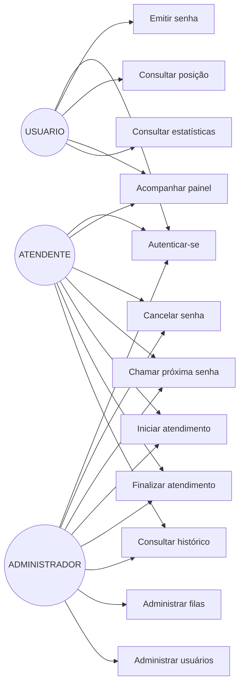
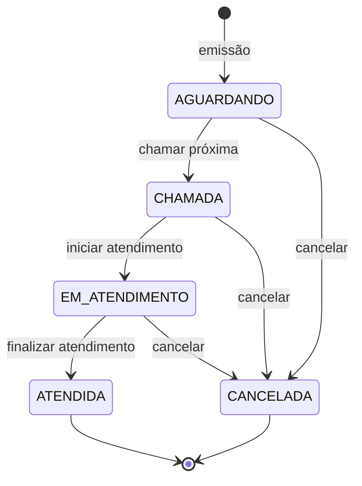

# Levantamento de Requisitos — API de Fila de Atendimento

> Documento de requisitos do MVP desenvolvido para o **Programa Residência em TIC (Capacita Brasil / iRede)**.
> Versão do sistema: **1.0.0** · Última atualização: **11/11/2026**

---

## 1. Contexto e escopo

O projeto resolve o controle de filas de atendimento presencial em instituições de ensino, órgãos públicos ou empresas. O escopo aprovado é **API-only (backend)**: não há interface gráfica neste repositório.

**Dentro do escopo:**

- Emissão de senhas com numeração diária por fila.
- Painel da fila, chamada FIFO e ciclo de vida da senha.
- Registro de atendimentos, histórico e estatísticas.
- Autenticação JWT e autorização por perfis.
- Administração de filas e usuários.
- Auditoria das transições de status.
- Empacotamento com Docker e documentação OpenAPI.

**Fora do escopo:**

- Frontend, totem ou painel visual.
- Aplicativo móvel.
- Notificações por SMS/e-mail/WhatsApp.
- Integração com catracas, leitores ou impressoras térmicas.
- Múltiplas unidades/tenant e faturamento.

---

## 2. Atores e perfis

| Ator | Perfil | Responsabilidades |
| --- | --- | --- |
| Cidadão / Aluno | `USUARIO` | Autentica-se, emite senha, consulta posição, acompanha painel e estatísticas. |
| Atendente | `ATENDENTE` | Tudo do perfil anterior + cancela senhas, chama a próxima, inicia e finaliza atendimentos, consulta histórico. |
| Administrador | `ADMINISTRADOR` | Tudo dos anteriores + CRUD de filas e usuários. Não pode desativar a própria conta. |
| Sistema | — | Garante numeração, FIFO, transições válidas, locks e auditoria. |

**Credenciais de demonstração (seed `V3`):**

| Perfil | E-mail | Senha |
| --- | --- | --- |
| ADMINISTRADOR | `admin@fila.local` | `Admin@123` |
| ATENDENTE | `atendente@fila.local` | `Atendente@123` |
| USUARIO | `usuario@fila.local` | `Usuario@123` |

---

## 3. Casos de uso

---

## 4. Requisitos funcionais

| ID | Requisito | Descrição | Endpoint | Prioridade |
| --- | --- | --- | --- | --- |
| **RF001** | Emitir senha | Gera senha `PREFIXO + 3 dígitos` para a fila informada (ou fila padrão), com sequência reiniciada diariamente. | `POST /api/senhas` | Must |
| **RF002** | Consultar última senha do dia | Retorna a última senha emitida hoje para a fila. | `GET /api/senhas/ultima` | Should |
| **RF003** | Painel da fila | Lista senhas `AGUARDANDO`, `CHAMADA` e `EM_ATENDIMENTO` em tempo real. | `GET /api/fila` | Must |
| **RF004** | Consultar senha e posição | Retorna dados da senha e, se `AGUARDANDO`, posição e pessoas à frente. | `GET /api/senhas/{id}` | Must |
| **RF005** | Estatísticas do dia | Totais por status, tempos médios de espera e atendimento, última emitida/chamada. | `GET /api/fila/estatisticas` | Should |
| **RF006** | Chamar próxima senha | Chama a senha mais antiga `AGUARDANDO` (FIFO), registra guichê e cria o atendimento. | `POST /api/fila/proxima` | Must |
| **RF007** | Iniciar atendimento | Marca o início efetivo da senha chamada. | `POST /api/atendimentos/iniciar` | Must |
| **RF008** | Finalizar atendimento | Encerra o atendimento, grava observação e muda a senha para `ATENDIDA`. | `POST /api/atendimentos/finalizar` | Must |
| **RF009** | Listar senhas | Lista paginada com filtros por status, fila e data. | `GET /api/senhas` | Should |
| **RF010** | Histórico de atendimentos | Lista paginada com filtros por período, guichê, atendente e status. | `GET /api/atendimentos` | Should |
| **RF011** | Consultar atendimento | Retorna um atendimento pelo identificador. | `GET /api/atendimentos/{id}` | Could |
| **RF012** | Cancelar senha | Cancela uma senha; o cancelamento é definitivo. | `POST /api/senhas/{id}/cancelar` | Must |
| **RF013** | Autenticar | Valida e-mail/senha e emite JWT; permite consultar o usuário autenticado. | `POST /api/auth/login` · `GET /api/auth/me` | Must |
| **RF014** | Administrar filas | Listar, consultar, criar, atualizar e desativar filas. | `/api/filas/**` | Should |
| **RF015** | Administrar usuários | Listar, consultar, criar, atualizar e desativar usuários (exclusão lógica). | `/api/usuarios/**` | Should |
| **RF016** | Auditar transições | Registrar automaticamente toda mudança de status em `senha_eventos` com autor e horário. | Persistência interna (RN007) | Must |
| **RF017** | Resolver fila padrão | Quando `filaId` é omitido, usar a fila cujo prefixo é `FILA_PREFIXO_PADRAO` (`A`). | Transversal | Should |
| **RF018** | Suportar múltiplas filas | Permitir filas independentes, cada uma com prefixo único e numeração própria. | `/api/filas` | Should |

### 4.1 Regras de validação dos payloads

| Campo | Regra |
| --- | --- |
| `nome` (usuário) | Obrigatório, até 120 caracteres |
| `email` | Obrigatório, formato válido, até 150 caracteres, único (case-insensitive) |
| `senha` | Obrigatória na criação, 8 a 72 caracteres |
| `perfil` | Obrigatório: `USUARIO`, `ATENDENTE` ou `ADMINISTRADOR` |
| `nome` (fila) | Obrigatório, até 80 caracteres, único |
| `prefixo` | Obrigatório, 1 letra (`[A-Za-z]`), único, normalizado para maiúscula |
| `filaId` / `senhaId` / `atendimentoId` | Inteiro positivo |
| `guiche` | Até 20 caracteres |
| `observacao` | Até 500 caracteres |

---

## 5. Regras de negócio

| ID | Regra | Implementação |
| --- | --- | --- |
| **RN001** | Numeração sequencial por fila, reiniciada a cada dia; formato `PREFIXO` + 3 dígitos. | `Fila.proximaSequencia`, `NumeroSenhaUtil`, lock pessimista em `FilaRepository.findByIdParaAtualizacao` |
| **RN002** | Chamada estritamente FIFO (menor `dataGeracao`/`sequencia`). | `SenhaRepository.buscarPrimeiras` com `PESSIMISTIC_WRITE` |
| **RN003** | Apenas senha `AGUARDANDO` pode ser chamada. | `Senha.chamar` |
| **RN004** | Cada senha possui no máximo um atendimento. | `UNIQUE (senha_id)` + `@OneToOne` |
| **RN005** | Só finaliza atendimento iniciado; ao finalizar, a senha vira `ATENDIDA`. | `Senha.finalizarAtendimento`, `Atendimento.finalizar` |
| **RN006** | Cancelamento é definitivo; a senha não volta à fila. | `Senha.cancelar` + estados terminais |
| **RN007** | Toda transição de status é auditada. | `SenhaEventoService` → `senha_eventos` |
| **RN008** | Fila inativa não emite nem chama senhas. | `SenhaService.gerar`, `FilaService.chamarProxima` |
| **RN009** | Administrador não pode desativar a si mesmo. | `UsuarioService.desativar` |
| **RN010** | Exclusões de fila/usuário são lógicas (preservam histórico). | `desativar` (`ativa=false` / `ativo=false`) |
| **RN011** | Senha cancelada não pode ser chamada novamente. | `Senha.chamar` exige `AGUARDANDO` |
| **RN012** | Duplicidade de e-mail, nome de fila ou prefixo é rejeitada. | `existsByEmailIgnoreCase`, `existsByNomeIgnoreCase`, `existsByPrefixoIgnoreCase` |

### 5.1 Ciclo de vida da senha

`ATENDIDA` e `CANCELADA` são terminais e disparam HTTP **409** em qualquer nova transição.

---

## 6. Requisitos não funcionais

| ID | Categoria | Requisito | Meta / evidência |
| --- | --- | --- | --- |
| **RNF001** | Tecnologia | Java 21 + Spring Boot 3.5.16 | `pom.xml`, build Docker |
| **RNF002** | Interoperabilidade | API REST/JSON com contrato OpenAPI 3 | Swagger UI e `/v3/api-docs` (17 paths) |
| **RNF003** | Segurança | Autenticação JWT HS256, senhas BCrypt, RBAC com 3 perfis | `SecurityConfig`, `JwtService`, testes de 401/403 |
| **RNF004** | Segurança | Sem sessão de servidor, CSRF desabilitado, CORS configurável, sem stack trace exposto | `SessionCreationPolicy.STATELESS`, `server.error.include-*: never` |
| **RNF005** | Persistência | PostgreSQL 16 com schema versionado por Flyway e `ddl-auto=validate` | Migrações `V1`–`V3` |
| **RNF006** | Consistência | Emissão e chamada seguras sob concorrência | Lock pessimista + `@Version` + constraints únicas |
| **RNF007** | Desempenho | Paginação padrão de 20 (máx. 100) e índices para consultas críticas | `PageableDefault`, `V2__criar_indices.sql` |
| **RNF008** | Disponibilidade | Healthchecks de API e banco no Compose | `fila-api` e `fila-postgres` `healthy` |
| **RNF009** | Portabilidade | Execução local ou em container | Dockerfile multi-stage + `docker compose up` |
| **RNF010** | Qualidade | Cobertura mínima de 80% de linhas, com gate de build | JaCoCo; resultado real **93,3% (725/777)** |
| **RNF011** | Testabilidade | Testes unitários e de integração isolados | 120 testes; H2 em modo PostgreSQL |
| **RNF012** | Observabilidade | Health/info e correlação de requisições | Actuator + `X-Request-Id`/MDC |
| **RNF013** | Manutenibilidade | Separação de camadas, DTOs, mappers e baixo acoplamento | Clean Architecture *inspired* + SOLID |
| **RNF014** | Usabilidade da API | Erros padronizados e mensagens de validação | RFC 9457 (`ProblemDetail`) |
| **RNF015** | Internacionalização temporal | Fuso configurável e consistente em domínio e auditoria | `APP_TIMEZONE` + `TimeConfig` |
| **RNF016** | Documentação | README, arquitetura, MER, API, testes e coleção Postman | pasta `docs/` |
| **RNF017** | Configuração | Credenciais e segredos via variáveis de ambiente | `.env.example`, placeholders `${ENV:default}` |

> **Observação:** RNF010 é verificado automaticamente no `mvn verify`; o build falha se a cobertura de linhas cair abaixo de 80%.

---

## 7. Matriz de rastreabilidade

| Requisito | Endpoint / artefato | Serviço | Teste principal |
| --- | --- | --- | --- |
| RF001 / RN001 | `POST /api/senhas` | `SenhaService.gerar` | `SenhaServiceTest`, `SenhaControllerIntegrationTest` |
| RF002 | `GET /api/senhas/ultima` | `SenhaService.ultima` | `SenhaServiceTest` |
| RF003 / RF005 | `GET /api/fila`, `/estatisticas` | `FilaService.consultar`, `estatisticas` | `FilaServiceTest`, `FilaControllerIntegrationTest` |
| RF004 | `GET /api/senhas/{id}` | `SenhaService.buscarPorId` | `SenhaServiceTest` |
| RF006 / RN002 | `POST /api/fila/proxima` | `FilaService.chamarProxima` | `FilaServiceTest` |
| RF007 | `POST /api/atendimentos/iniciar` | `AtendimentoService.iniciar` | `AtendimentoServiceTest` |
| RF008 / RN005 | `POST /api/atendimentos/finalizar` | `AtendimentoService.finalizar` | `AtendimentoServiceTest` |
| RF009 | `GET /api/senhas` | `SenhaService.listar` | `SenhaControllerIntegrationTest` |
| RF010 | `GET /api/atendimentos` | `AtendimentoService.listar` | `AtendimentoServiceTest` |
| RF012 / RN006 | `POST /api/senhas/{id}/cancelar` | `SenhaService.cancelar` | `SenhaTest`, `SenhaServiceTest` |
| RF013 | `/api/auth/**` | `AuthService`, `JwtService` | `AuthControllerIntegrationTest`, `JwtServiceTest` |
| RF014 | `/api/filas/**` | `FilaAdminService` | `FilaAdminServiceTest`, `FilaAdminControllerIntegrationTest` |
| RF015 / RN009 | `/api/usuarios/**` | `UsuarioService` | `UsuarioServiceTest`, `UsuarioControllerIntegrationTest` |
| RF016 / RN007 | `senha_eventos` | `SenhaEventoService` | `SenhaServiceTest`, `AtendimentoServiceTest` |
| RN003 / RN005 / RN006 | Entidades | `Senha`, `Atendimento` | `SenhaTest` (11 casos), `AtendimentoServiceTest` |

---

## 8. Premissas e restrições

- A aplicação é executada como instância única no MVP; os locks garantem consistência mesmo com múltiplas instâncias no mesmo banco.
- O relógio do servidor é confiável; o fuso é configurável por `APP_TIMEZONE`.
- O banco é PostgreSQL 16 em produção e H2 (modo PostgreSQL) nos testes.
- A numeração reinicia à meia-noite no fuso configurado (`America/Sao_Paulo` por padrão).
- Não há integração com sistemas externos.
- O token JWT não possui refresh; ao expirar (2 h por padrão), é necessário novo login.

---

## 9. Critérios de aceite

1. `POST /api/senhas` retorna **201** com `Location` e número no formato `A001`.
2. Emitir duas senhas no mesmo dia gera `A001` e `A002`; no dia seguinte, volta a `A001`.
3. `POST /api/fila/proxima` retorna **200** com a senha mais antiga e cria atendimento.
4. `POST /api/atendimentos/iniciar` só funciona para senha `CHAMADA` (senão **409**).
5. `POST /api/atendimentos/finalizar` só funciona para atendimento iniciado (senão **409**).
6. Requisição sem token recebe **401**; perfil sem permissão recebe **403**.
7. `GET /actuator/health` retorna `UP` com banco acessível.
8. `mvn verify` termina com **BUILD SUCCESS**, 120 testes e cobertura ≥ 80%.
9. `docker compose up --build` sobe API e banco saudáveis, com migrações aplicadas.
10. Swagger UI acessível em `/swagger-ui/index.html` com todos os endpoints documentados.

---

## 10. Referências

- Documento de arquitetura: [`ARQUITETURA.md`](ARQUITETURA.md)
- Modelo de dados e DER: [`MER.md`](MER.md)
- Referência da API: [`API.md`](API.md)
- Estratégia de testes: [`TESTES.md`](TESTES.md)
- Relatório acadêmico: [`RELATORIO-ACADEMICO.md`](RELATORIO-ACADEMICO.md)
